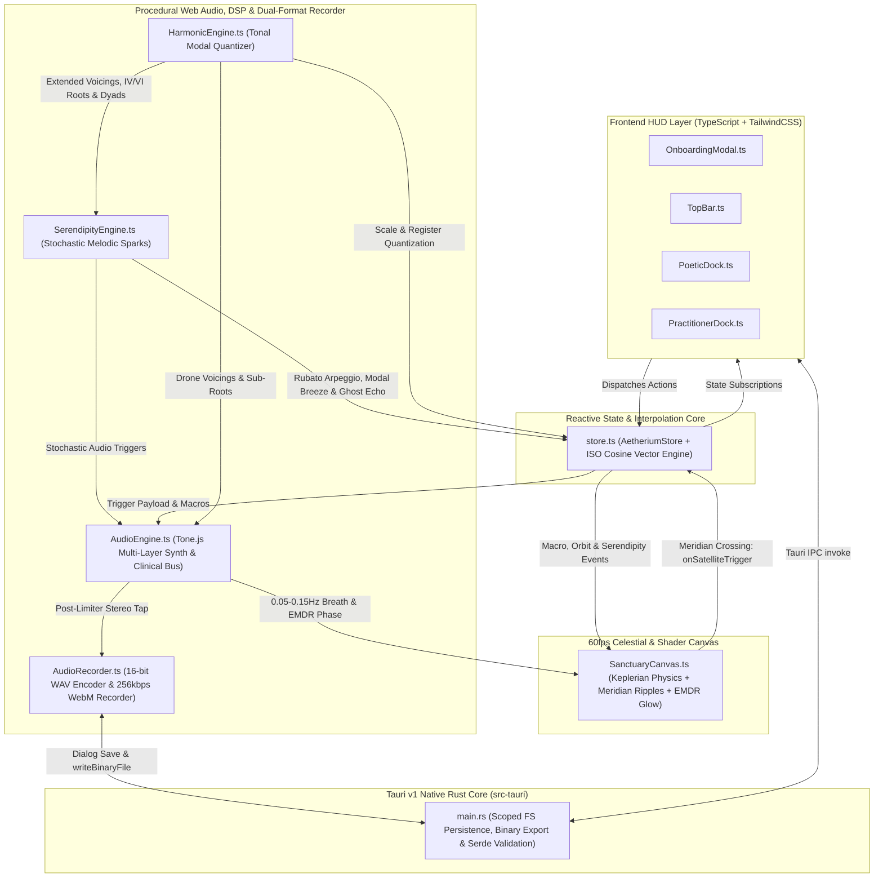

# AETHERIUM

**Unified Multi-Platform Generative Ambient Soundscape & Receptive Music Therapy Sanctuary (`voidwave-lab`)**

[](./LICENSE)
[](./TRANSPARENCY.md)
[](#part-iv-ethics-open-source-credits-academic-bibliography--gnu-gpl-v30-license)
[-cyan.svg)](#4-multi-layer-procedural-web-audio--psychoacoustic-dsp-graph)

> 🌐 **Language / Limba:** [**English (`README.md`)**](./README.md) | [**Română (`README.ro.md`)**](./README.ro.md)

Aetherium is a free, open-source, unified multi-platform sanctuary built by **[voidwave-lab](https://github.com/voidwave-lab)** for **macOS**, **Windows**, **Linux** (via Tauri v1), and **iOS**, **Android**, & **Mobile Web / PWA** ("**Aetherium Pocket**" via Capacitor & Service Worker). It synthesizes continuous, never-repeating ambient music and clinical soundscapes in real time—requiring zero musical training, zero internet connection, and zero external audio samples.

It is designed for two distinct user groups:
- **Solo Explorer**: Everyday listeners seeking nervous-system self-regulation, deep focus, contemplative drift, or restorative sleep.
- **Practitioner / Guide**: Psychologists, psychiatrists, EMDR clinicians, and music therapists conducting spoken therapy, somatic grounding, and guided emotional regulation in clinical settings.

---

## Table of Contents

1. [Part I: For Listeners & Practitioners (No Coding Required)](#part-i-for-listeners--practitioners-no-coding-required)
   - [How to Download & Install](#1-how-to-download--install)
   - [Choosing Your Space: Solo Explorer vs. Practitioner / Guide](#2-choosing-your-space-solo-explorer-vs-practitioner--guide)
2. [Part II: Technical Architecture, DSP Signal Flow & Mathematical Models](#part-ii-technical-architecture-dsp-signal-flow--mathematical-models)
   - [System Architecture Overview](#1-system-architecture-overview)
   - [Keplerian Orbital Physics & Meridian Trigger Detection](#2-keplerian-orbital-physics--meridian-trigger-detection)
   - [Harmonic Quantization & Modal Morphing Engine](#3-harmonic-quantization--modal-morphing-engine)
   - [Multi-Layer Procedural Web Audio & Psychoacoustic DSP Graph](#4-multi-layer-procedural-web-audio--psychoacoustic-dsp-graph)
   - [Serendipity Engine: Stochastic Melodic Sparks & Ephemeral Phenomena](#5-serendipity-engine-stochastic-melodic-sparks--ephemeral-phenomena)
   - [Clinical Suite DSP & Automated ISO-Principle Vector Interpolation](#6-clinical-suite-dsp--automated-iso-principle-vector-interpolation)
   - [Studio-Quality Audio Recorder & Clinical "Take-Home" Export (`.wav` & `.webm`)](#7-studio-quality-audio-recorder--clinical-take-home-export-wav--webm)
   - [Procedural 2D Atmospheric Rendering Pipeline](#8-procedural-2d-atmospheric-rendering-pipeline)
   - [Rust / Tauri v1 Native Backend & Binary Optimization](#9-rust--tauri-v1-native-backend--binary-optimization)
3. [Part III: For Developers (Building from Source)](#part-iii-for-developers-building-from-source)
4. [Part IV: Ethics, Open-Source Credits, Academic Bibliography & GNU GPL v3.0 License](#part-iv-ethics-open-source-credits-academic-bibliography--gnu-gpl-v30-license)
   - [A. The Commons Philosophy & Ethical AI Attribution](#a-the-commons-philosophy--ethical-ai-attribution)
   - [B. Open-Source Ecosystem & Direct Repository Links](#b-open-source-ecosystem--direct-repository-links)
   - [C. Foundational Bibliography (DSP, Generative Music & Psychoacoustics)](#c-foundational-bibliography-dsp-generative-music--psychoacoustics)
   - [D. Clinical & Therapeutic Disclaimer](#d-clinical--therapeutic-disclaimer)
   - [E. Free Forever Guarantee (GNU GPL v3.0 Summary)](#e-free-forever-guarantee-gnu-gpl-v30-summary)

---

# Part I: For Listeners & Practitioners (No Coding Required)

You do **not** need to install any programming tools or write any code to use Aetherium.

## 1. How to Download & Install

1. Visit the [**Releases Page**](../../releases) of this repository on GitHub.
2. Under the latest release, open the **Assets** section and download the installer for your computer:
   - **macOS (Apple Silicon M1 / M2 / M3 / M4):** Download `Aetherium_..._aarch64.dmg`
   - **macOS (Intel Mac):** Download `Aetherium_..._x64.dmg`
     - *macOS First-Launch Tip:* Open the `.dmg` and drag **Aetherium** into your **Applications** folder. If macOS Gatekeeper displays an *"unidentified developer"* prompt on first launch, **Right-Click (or Control-Click) `Aetherium.app` → select Open**.
   - **Windows (Windows 10 / 11):** Download `Aetherium_..._x64-setup.exe` (or `.msi`) and double-click to run the installer.
     - *Windows First-Launch Tip:* If Windows SmartScreen appears, click **More info → Run anyway**.
   - **Linux (Ubuntu / Debian / Mint / Fedora):** Download `Aetherium_..._amd64.AppImage` (make it executable with `chmod +x Aetherium*.AppImage` and double-click) or install the Debian package (`sudo dpkg -i Aetherium_..._amd64.deb`).
   - **Mobile Web / Instant PWA ("Aetherium Pocket"):** Open [`https://voidwave-lab.github.io/Aetherium/pocket.html`](https://voidwave-lab.github.io/Aetherium/pocket.html) on iOS Safari or Android Chrome and select **Share → Add to Home Screen** for a 100% offline, full-screen portrait sanctuary with Lock Screen media controls, Battery Guard, Gyroscope Tilt, and an overnight Sleep Timer (`15m` / `30m` / `45m` / `60m`).
   - **Native Android (`.apk`) & iOS (Xcode / TestFlight):** Download `Aetherium-Pocket.apk` directly from the GitHub Releases page, or build for iOS / Android via Capacitor (`npm run cap:sync`).

---

## 2. Choosing Your Space: Solo Explorer vs. Practitioner / Guide

When you launch Aetherium, a minimalist glass overlay asks you to **Select Your Space** (you can switch between spaces at any time using the pill button in the top-right corner).

### Mode A: Solo Explorer (Personal Sanctuary)

Designed for pure, distraction-free tactile interaction:

1. **Awaken the Sanctuary:** Click **Awaken Audio** in the bottom dock to start the continuous harmonic drone.
2. **The Orbital Canvas:**
   - **The Central Core:** Pulses gently at the center of the screen, breathing every 10–15 seconds. Dragging the Core slightly left or right shifts the stereo balance between your speakers or headphones.
   - **Harmonic Satellites (Up to 12 Nodes):** Click anywhere in the dark space around the Core to place an orbiting satellite.
   - **The 12 O'Clock Meridian (`XII`):** Every time a satellite crosses the glowing vertical line directly above the Core, it triggers a musical note mathematically locked to a consonant harmonic scale—you can never hit a dissonant or "wrong" note.
   - **Distance Controls Pitch & Speed:**
     - **Inner Orbits (Close to Core):** Orbit faster and play delicate, higher-register notes (Octaves 4–5).
     - **Middle Orbits:** Play warm midrange harmonies (Octaves 3–4).
     - **Outer Orbits (Far from Core):** Orbit slowly and play deep cello/bass register notes (Octaves 2–3).
   - **Reshaping & Dissolving:** Drag any satellite closer or further from the Core to change its pitch register; **right-click** (or **press and hold**) a satellite to dissolve it into particles.
3. **The Bottom Poetic Dock:**
   - **8 Procedural Seeds (Starting Moods & Synthesis Engines):**
     - *Rain on Felt* (intimate muted FM piano & distant rain)
     - *Deep Drift* (expansive Lydian space pad)
     - *Subterranean* (grounded dark sub-harmonic drone)
     - *Solar Wind* (warm, sunlit Maj9 consonance)
     - *Midnight Vinyl* (nocturnal Lo-Fi / Future Garage with `<600 Hz` Rhodes FM chords, `45–65 Hz` sub-bass, and stochastic `2.5 kHz` vinyl crackle)
     - *Singing Bowls* (clinical grounding via 4 inharmonic metallic partials `[1.0, 2.756, 5.404, 8.933]` with `0.08s` felt-mallet attack and `14s` decay)
     - *Cathedral Choir* (vowel formant synthesis morphing continuously between `'Ahh'` `[700, 1220, 2600 Hz]` and `'Ooo'` `[450, 800, 2830 Hz]`)
     - *Bowed Glass & Strings* (post-rock / cinematic `3.0s` slow-attack bowed strings & Karplus-Strong sympathetic resonance through a woody body filter bank with `4.5 Hz` vibrato)
   - **Luminance (*Shadow ↔ Light*):** Gradually shifts the musical scale from melancholic minor (*Aeolian / Phrygian*) through wistful *Dorian* and *Major 9th* into expansive *Lydian* wonder, while brightening the tone.
   - **Fog (*Clarity ↔ Mist*):** Wraps the soundscape in a deep, cathedral-like reverb and softens high frequencies into a distant mist.
   - **Viscosity (*Crystalline ↔ Dense*):** Slows the orbiting satellites down, lengthens their visual motion trails, and softens note attacks into slow swells.
   - **Nostalgia (*Pristine ↔ Worn*):** Adds gentle analog tape warmth, subtle pitch drift, distant rain/vinyl texture, and a soft sepia film grain.
   - **Rarity (*Present ↔ Silence*):** Controls how often a satellite crossing rests in silence instead of playing a note, giving the room space to breathe.
   - **Serendipity (*Stillness ↔ Sparks*):** Prevents auditory habituation by introducing gentle, unhurried musical surprises at irregular intervals (every 8 to 25 seconds)—such as a human-like *Rubato Arpeggio* accompanied by a shooting star across the outer canvas, a temporary *Modal Breeze* harmonic shift (`IV` or `VI`) with an expanding aurora ripple from the Core, or a distant *High-Octave Shimmer* in the upper mist. Set to `0% (Stillness)` for pure orbital predictability or raise toward `100% (Sparks)` for an evolving, living sky.
   - **Capture Sanctuary (Live Session Audio Recorder):** Click **Capture Sanctuary** next to the Play/Mute button to record your live generative session. While recording, a soft breathing amber/crimson halo and `MM:SS` timer appear. Clicking **Stop Capture** opens the **Save Recorded Sanctuary Audio** modal, where you can export your session with an auto-generated poetic filename (e.g., `Aetherium_RainOnFelt_2026-10-26.wav`) as either:
     - **Lossless Studio (`.wav`):** 16-bit Stereo PCM with an automatic 2-second cosine fade-in and 3-second cosine fade-out so the track loops seamlessly on mobile phones without clicks or pops.
     - **Mobile Compact (`.webm`):** 256 kbps compact audio stream ideal for lightweight mobile storage or sharing.
   - **Fade to Silence (Sleep Timer):** Click `15m`, `30m`, or `60m` next to the crescent moon icon to have Aetherium gently fade out and stop automatically.

---

### Mode B: Practitioner / Guide (Clinical Suite)

Switching to **Practitioner / Guide** mode reveals the collapsible **Practitioner Suite** lateral panel on the right side of the screen, purpose-built for psychotherapy, psychiatry, somatic experiencing, and EMDR sessions:

1. **Vocal-Range Carving (Dialogue Mode)**
   - *The Clinical Problem:* Standard background music occupies the $400\text{ Hz} - 2.5\text{ kHz}$ frequency range—the exact same spectrum as human speech—forcing the therapist and patient to speak over the music and causing cognitive fatigue.
   - *How It Works:* When **Dialogue ON** is active, Aetherium carves a smooth, wide acoustic pocket centered at $1100\text{ Hz}$ (adjustable from `0 dB` down to `-12 dB`). The room remains filled with comforting sub-bass warmth ($40\text{–}150\text{ Hz}$) and airy upper shimmer ($>3.5\text{ kHz}$), while spoken conversation remains effortless and crystal clear.

2. **Automated ISO-Principle Session Arc (Vector Pacing)**
   - *The Clinical Principle:* In Receptive Music Therapy, the **ISO Principle** states that music is most regulating when it first matches (*mirrors*) the patient's current emotional/autonomic state and then gradually guides them toward a regulated target state.
   - *How It Works:*
     1. Select your session length (`20m`, `45m`, `50m` standard clinical hour, or `60m`).
     2. Choose **Phase 1 — Mirroring (Start State)** to match how the patient arrives (e.g., *High Agitation / Tension*, *Melancholic / Heavy*, or *Dissociated / Flat*).
     3. Choose **Phase 2 — Co-Regulation (75% Target State)** (e.g., *Parasympathetic Rest / Safe Grounding* or *Warm Openness*).
     4. Click **Start Session Arc**. Aetherium automatically interpolates the musical scale, orbital pace, reverb mist, and harmonic warmth across the session—keeping **Serendipity** low (`5%`) during the deep parasympathetic middle phase and gently ramping it up (`35%`) alongside luminance and clarity during the **final 10% (Phase 3 — Re-Orientation)** so the patient's attention is softly awakened before leaving the office.

3. **Bilateral Grounding (EMDR / Somatic Panner)**
   - *How It Works:* Toggle **Bilateral Grounding** on to route the harmonic voices and a soft rhythmic pulse smoothly between the **Left** and **Right** audio channels (`0.2 Hz` slow meditative sweep up to `1.5 Hz` active processing pace, with adjustable stereo width from `0%` to `100%`).
   - *Visual + Auditory Tracking:* A soft cyan luminescence simultaneously oscillates across the left and right edges of the screen (paired with a horizontal tracking beacon) so the patient can track the bilateral rhythm visually, auditorily, or both.
   - *Clinical Safety Guard (Serendipity Auto-Lock):* Whenever Bilateral EMDR mode is active, Aetherium automatically clamps **Serendipity** to `0%` (canceling any active comets or modal shifts) so random melodic or visual sparks never distract the patient from bilateral tracking.

4. **Somatic Sub-Bass ($40\text{–}60\text{ Hz}$) & Binaural Theta Entrainment**
   - **Somatic Sub-Bass Anchor ($40\text{–}60\text{ Hz}$):** Boosts a pure, warm sub-fundamental sine wave that creates a comforting physical sensation of grounding in the room or headphones for anxious or dissociating patients.
   - **Binaural Theta (`100Hz L / 106Hz R`):** For headphone sessions, toggling **6Hz ON** sends $100\text{ Hz}$ to the left ear and $106\text{ Hz}$ to the right ear, generating a gentle $6\text{ Hz}$ Theta binaural beat organically masked beneath the music.
   - **Session Presets:** Save custom clinical configurations to quick one-click slots or export/import `.aether.json` files to share across clinic computers.

5. **Patient Take-Home Anchor (Timed Audio Prescription)**
   - *The Clinical Use Case:* Patients frequently benefit from taking home the exact regulated acoustic environment co-created during their therapy session to practice grounding between appointments.
   - *How It Works:* Under **5. Patient Take-Home Anchor**, click **`Capture 3 Min Loop`**, **`Capture 5 Min Anchor`**, or **`Capture 10 Min Rest`**. Aetherium automatically records the active therapeutic state (including Vocal-Range Carving, Bilateral EMDR panning, or Somatic Sub-Bass if enabled), displays a calm progress bar (with an option to **Finish & Export Now** early), applies a 2-second cosine fade-in and 3-second cosine fade-out for click-free looping, and automatically prompts to save as **Lossless Studio (`.wav`)** or **Mobile Compact (`.webm` · WhatsApp/Email friendly)** when the timer completes.

---

# Part II: Technical Architecture, DSP Signal Flow & Mathematical Models

This section details **what** Aetherium implements under the hood and **how** each subsystem is engineered.

## 1. System Architecture Overview

Aetherium is architected as a zero-dependency-bloat, event-driven desktop application split into four tightly decoupled layers:



---

## 2. Keplerian Orbital Physics & Meridian Trigger Detection

Implemented in [`src/canvas/SanctuaryCanvas.ts`](./src/canvas/SanctuaryCanvas.ts), the viewport replaces linear DAW timelines with a polar gravitational coordinate system centered on the **Central Attractor (The Core)**.

### Elliptical Orbit Geometry
Each satellite node $i \in [1, 12]$ stores a normalized semi-major axis $a \in [0.14, 0.94]$, orbital eccentricity $e \in [0.04, 0.24]$, argument of periapsis $\omega$, and true anomaly angle $\theta \in [-\pi, \pi]$. Instantaneous radial distance from the Core is computed via the Keplerian conic section equation:

$$r(\theta) = \frac{a(1 - e^2)}{1 + e \cos(\theta - \omega)}$$

### Angular Velocity & Viscosity Damping
Following Kepler's Second and Third Laws of planetary motion, angular velocity is inversely proportional to $r^{3/2}$ (implemented with a tuned exponent of $1.42$ for tactile playability) and modulated by both the **Viscosity** macro parameter ($v \in [0, 1]$) and the **ISO-Principle Orbital Pace Multiplier** ($m_{\text{iso}}$):

$$\frac{d\theta}{dt} = \frac{k_0}{\max(0.14, r(\theta))^{1.42}} \cdot (1 - 0.68v) \cdot m_{\text{iso}}$$

where $k_0 = 0.22\text{ rad/s}$. Inner satellites ($a \approx 0.14$) complete orbits rapidly, whereas outer satellites ($a \approx 0.90$) drift across long meditative cycles.

### North Meridian Crossing Detection
The **Meridian (`XII`)** is positioned at $\theta_{\text{meridian}} = -\frac{\pi}{2}$ (12 o'clock North). On every animation frame $\Delta t$, if a satellite's previous angle $\theta_{t-1}$ and updated angle $\theta_t$ satisfy:

$$\theta_{t-1} < -\frac{\pi}{2} \le \theta_t$$

the canvas invokes `store.emitSatelliteTrigger(sat)`, which dispatches a DOM `CustomEvent('onSatelliteTrigger', { detail })` on `window`, notifies all registered audio listeners, flashes the Meridian filament, and spawns an expanding radial luminescence ripple at the crossing coordinate.

---

## 3. Harmonic Quantization & Modal Morphing Engine

Implemented in [`src/audio/HarmonicEngine.ts`](./src/audio/HarmonicEngine.ts) using the `Tonal` music-theory library, Aetherium guarantees that user interactions never produce harsh or accidental dissonance.

### Luminance-Driven Modal State Machine
The `Luminance` macro parameter ($L \in [0.0, 1.0]$) acts as a continuous harmonic brightness vector that morphs both the active scale pitch-class set and the continuous Core Drone 4-note chord voicing across four psychoacoustic zones:

| Luminance Range | Harmonic Zone ID | Musical Mode & Voicing | Emotional / Psychoacoustic Profile |
| :--- | :--- | :--- | :--- |
| **`0.00 – 0.25`** | `shadow-aeolian` | **Aeolian (Natural Minor)** or **Phrygian** (`C` / `D`) | Deep melancholic shadow, grounded introspection |
| **`0.25 – 0.50`** | `wistful-dorian` | **Dorian Mode** with $\text{min7}$ & $\text{add9}$ extensions | Intimate, wistful warmth (raised natural 6th + 9th) |
| **`0.50 – 0.75`** | `floating-maj9` | **Major Pentatonic / $\text{Maj9}$** (`1, 9, 3, 5, 6, 7`) | Open, floating, reassuring consonance |
| **`0.75 – 1.00`** | `cosmic-lydian` | **Lydian Mode** ($\sharp 4 / \sharp 11$ raised fourth) | Expansive, weightless space-ambient wonder |

### Orbital Radius-to-Octave Register Mapping
When a satellite is spawned or dragged to a new orbital radius $a$, `HarmonicEngine.mapRadiusToOctave(a)` maps its distance from the Core to a specific psychoacoustic pitch register:
- **Inner Orbits ($0.14 \le a < 0.38$):** Crystalline upper register (**Octaves 4–5**).
- **Middle Orbits ($0.38 \le a < 0.68$):** Warm midrange body (**Octaves 3–4**).
- **Outer Orbits ($0.68 \le a \le 0.94$):** Deep cello and bass register (**Octaves 2–3**).

### Rarity (Probabilistic Entropy Gate)
Before a Meridian crossing triggers audio synthesis, `store.emitSatelliteTrigger` evaluates a Bernoulli trial against the `Rarity` slider ($R \in [0, 1]$):

$$P(\text{silence}) = 0.90 \cdot R$$

When the entropy gate skips a trigger (`silencedByRarity = true`), the audio engine remains silent while the canvas renders a muted slate-grey pulse (`· silence`), introducing organic breathing room into the composition.

---

## 4. Multi-Layer Procedural Web Audio & Psychoacoustic DSP Graph

Implemented in [`src/audio/AudioEngine.ts`](./src/audio/AudioEngine.ts) using **Web Audio API** and **Tone.js**, all sound is synthesized procedurally in real time (zero external `.mp3` or `.wav` assets). Every parameter transition uses `rampTo(value, 0.2)` ($200\text{ ms}$ smoothing) to prevent zipper noise or phase clicks.

```mermaid
flowchart LR
    subgraph LAYERS["3 Procedural Synthesis Layers"]
        direction TB
        LA["Layer A: Core Drone\n3x FatSawtooth Pad + -12dB Sub-Sine\n→ 24dB LPF (0.05-0.15Hz Breath LFO)"]
        LB["Layer B: Satellite Voices\n1. FM Felt Piano Pluck\n2. Slow-Attack (1.5-4s) AM Glassy Pad"]
        LC["Layer C: Organic Texture\nPink + Brown Noise\n→ 0.065Hz Swept Bandpass Filter"]
    end

    subgraph PAN["Spatial & EMDR Stage"]
        CP["Core Panner (coreOffset.x)"]
        BP["Bilateral EMDR Panner\n(0.2-1.5Hz Sine LFO + Harmonic Pulse)"]
    end

    subgraph MACRO_BUS["Poetic Macro DSP Bus"]
        WS["Nostalgia Soft-Clip WaveShaper\n(tanh saturation curve)"]
        TD["Nostalgia Tape Delay\n(0.8Hz Wow & Flutter LFO)"]
        PP["Stereo PingPongDelay\n(Viscosity + Fog feedback)"]
        RV["Freeverb + Convolution Reverb\n(2s to 18s effective decay)"]
        LPF["Fog Master Low-Pass Filter\n(12kHz → 1.2kHz roll-off)"]
    end

    subgraph CLINICAL_BUS["Clinical & Master Protection Bus"]
        VC["Vocal-Range Carving EQ\n(1100Hz, Q=0.7, 0 to -12dB)"]
        SUB["Somatic Sub-Bass (40-60Hz Sine)\n& Binaural Theta (100Hz L / 106Hz R)"]
        MG["Master Gain & Sleep Fade"]
        CMP["Master Glue Compressor\n(-15dB, 3.2:1)"]
        LIM["Brickwall Limiter (-1.0 dBFS)"]
    end

    LA --> CP --> WS
    LB --> BP --> WS
    WS --> TD --> PP --> RV --> LPF
    LC --> LPF
    LPF --> VC --> MG
    SUB -->|Bypasses Midrange Notch| MG
    MG --> CMP --> LIM --> OUT(("Audio Output"))
```



### Synthesis Layer Details
1. **Layer A — The Core Drone:**
   - **Pad Foundation:** `Tone.PolySynth(Tone.Synth)` configured with a 3-oscillator detuned sawtooth (`type: 'fatsawtooth'`, `spread: 24 cents`) playing the active 4-note modal voicing.
   - **Sub-Fundamental Anchor:** Dedicated `Tone.Synth` (`type: 'sine'`, attenuated at `-12 dB` relative to the pad) locked to `rootNote + 1` (e.g., `C1`, `D1`, `F1`, `G1`).
   - **Respiratory Filter Modulation:** Both oscillators feed a resonant `24 dB/oct` low-pass filter (`Q = 2.1`) whose cutoff frequency is swept by a slow sinusoidal LFO (`0.05 Hz` to `0.15 Hz`, corresponding to a 6.6-to-20-second respiratory cycle). The instantaneous phase of this LFO is exposed via `audioEngine.getBreathingModulation(timeSec)` so the visual Core on the canvas expands and contracts in exact synchrony with the acoustic filter swell.
2. **Layer B — 6 Procedural Seed Synthesis Engines:**
   - **Engine 1 (Felt Piano / Intimate Pluck):** Polyphonic `Tone.FMSynth` (`harmonicity: 2.0`, `modulationIndex: 1.2 + 1.4 * luminance`, triangle modulator with fast decay) producing a soft, muted felt-hammer transient followed by a warm woody decay (`attack: 0.015s – 0.28s`, `release: 1.8s – 6.5s`).
   - **Engine 2 (Glassy Space Pad):** Polyphonic `Tone.AMSynth` (`harmonicity: 1.5` fifth overtone shimmer, dual `fatsine` carrier) with a click-free slow attack (`1.5s – 4.0s` scaled by `viscosity`) and long halo release (`3.0s – 8.5s`).
   - **Engine 3 (Midnight Vinyl — Nocturnal Lo-Fi / Future Garage):** Warm Rhodes FM electric piano dyads (`harmonicity: 1.0`) routed through a dedicated `24 dB/oct` low-pass filter (`< 600 Hz`), paired with an automatic `55 Hz` (`45–65 Hz`) sub-bass sine anchor and a stochastic micro-impulse generator filtered through a `2.5 kHz` bandpass resonator (`Q = 3.4`) for vinyl crackle and nocturnal rain.
   - **Engine 4 (Singing Bowls — Inharmonic Modal Synthesis):** 4 parallel `Tone.PolySynth` sine banks tuned to Euler-Bernoulli metallic mode ratios ($[1.000,\ 2.756,\ 5.404,\ 8.933] \times f_0$) with a `0.08s` felt-mallet attack and staggered ultra-long modal decays up to `14.0s`.
   - **Engine 5 (Cathedral Choir — Vowel Formant Synthesis):** Routes a 4-voice detuned sawtooth choir synth and a continuous send from the Core Drone through 3 parallel high-$Q$ bandpass filters ($F_1, F_2, F_3$) that continuously morph between Vowel `'Ahh'` ($[700\text{ Hz},\ 1220\text{ Hz},\ 2600\text{ Hz}]$) and Vowel `'Ooo'` ($[450\text{ Hz},\ 800\text{ Hz},\ 2830\text{ Hz}]$).
   - **Engine 6 (Bowed Glass & Strings — Post-Rock / Cinematic):** Combines a `3.0s` slow-attack AM bowed `fatsawtooth`/`triangle` synth and a physical-modeling Karplus-Strong `Tone.PluckSynth` routed through a 3-band woody body-resonance filter bank ($250\text{ Hz}$ cavity, $520\text{ Hz}$ bridge, $1850\text{ Hz}$ rosin sheen) with a `4.5 Hz` organic vibrato.
3. **Layer C — Organic Texture Generator:**
   - Dual procedural `Tone.Noise('pink')` and `Tone.Noise('brown')` generators routed through a `12 dB/oct` bandpass filter (`Q = 1.8`) swept continuously between `240 Hz` and `1,180 Hz` by a `0.065 Hz` LFO, emulating distant rain on felt, wind through pines, or warm analog room tone.

### Poetic Macro DSP Equations
- **Fog ($F \in [0, 1]$):** Controls the wet mix and room size of a cascaded `Tone.Freeverb` + `Tone.Reverb` network (scaling effective decay from $2\text{s}$ up to $18\text{s}$) while exponentially rolling off the Master Low-Pass Filter cutoff from $12\text{ kHz}$ down to $1.2\text{ kHz}$:

$$f_{\text{fog}}(F, L) = \text{clamp}\left(12000 \cdot \left(\frac{1200}{12000}\right)^F \cdot (0.75 + 0.50L),\ 950,\ 14000\right)\text{ Hz}$$

- **Nostalgia ($N \in [0, 1]$):**
  1. Modulates a short delay line (`12 ms` center) with a `0.8 Hz` sine LFO by $\pm 3.8N\text{ ms}$ to create authentic analog tape *wow & flutter* pitch drift.
  2. Drives a 1024-point hyperbolic tangent soft-clipping waveshaper for warm midrange saturation:

$$y(x) = \frac{\tanh(k \cdot x)}{\tanh(k)}, \quad k = 0.6 + 2.2N$$

---

## 5. Serendipity Engine: Stochastic Melodic Sparks & Ephemeral Phenomena

Implemented in [`src/audio/SerendipityEngine.ts`](./src/audio/SerendipityEngine.ts), [`src/audio/HarmonicEngine.ts`](./src/audio/HarmonicEngine.ts), and [`src/canvas/SanctuaryCanvas.ts`](./src/canvas/SanctuaryCanvas.ts), the **Serendipity** module ($S \in [0.0, 1.0]$) prevents auditory habituation across long sessions while preserving a non-startling, meditative acoustic envelope.

### 1. Inverse-Scaled Stochastic Evaluation Scheduler
When playback is active and $S_{\text{eff}} > 0.01$, `SerendipityEngine` schedules its next evaluation window $[T_{\min}, T_{\max}]$ inversely proportional to $S_{\text{eff}}$:

$$T_{\min}(S_{\text{eff}}) = 8.0 + 11.0(1 - S_{\text{eff}})\text{ s}, \quad T_{\max}(S_{\text{eff}}) = 12.0 + 13.0(1 - S_{\text{eff}})\text{ s}$$

At low Serendipity ($S_{\text{eff}} \to 0.05$), events occur sparsely every $18.5\text{–}24.4\text{ seconds}$; at maximum Serendipity ($S_{\text{eff}} = 1.0$), events bloom every $8.0\text{–}12.0\text{ seconds}$.

### 2. Weighted Musical Phenomena & Synchronized Canvas Visuals
On each evaluation tick, a uniform random draw $u \sim \mathcal{U}(0, 1)$ selects one of three musical-visual events:

| Event Type | Weight | Musical & Psychoacoustic Implementation | Ephemeral Canvas Phenomenon (`SanctuaryCanvas.ts`) |
| :--- | :--- | :--- | :--- |
| **Event A: Rubato Arpeggio** | **60%** ($u < 0.60$) | Picks $N \in \{3, 4, 5\}$ notes from the active scale favoring warm extensions (**Root, 5th, 7th, 9th, 11th** in **Octaves 4–5**). Plays them sequentially with humanized, decelerating rubato inter-onset intervals ($\Delta t_i = 350 + 430(i/(N-1))^{1.45} + \epsilon\text{ ms} \in [350, 900]\text{ ms}$) and low tapering velocity ($0.18\text{–}0.30$). | Spawns a **Shooting Star / Comet** (`SerendipityComet`) gliding along the outer orbital arc ($0.84\text{–}1.02\ R_{\max}$). Its glowing tail and nucleus pulse in synchrony with each note's exact timestamp, shedding stardust motes labeled with the note name. |
| **Event B: Modal Breeze / Root Shift** | **20%** ($0.60 \le u < 0.80$) | Temporarily shifts the Core Drone voicing, somatic sub-bass, and satellite pitch quantization root to the **Subdominant ($\text{IV}$)** or **Submediant ($\text{VI}$)** degree of the current scale for $16\text{–}24\text{ seconds}$, then glides smoothly back to the home tonic ($\text{I}$). | Spawns a slow, multi-stop **Aurora Color Ripple** (`ModalAuroraRipple`) expanding radially outward from the Central Core across the background fog, accompanied by a subtle `MODAL BREEZE · IV / VI` telemetry badge below the Core. |
| **Event C: High-Octave Shimmer / Ghost Echo** | **20%** ($u \ge 0.80$) | Triggers a crystalline harmonic dyad (**5th** or **3rd** interval in **Octave 5**) on a dedicated `fatsine` AM synth (`ghostShimmerSynth`) routed **100% wet** through a dedicated long-tail convolution reverb bus (`ghostShimmerReverb`, `decay: 9.5s`, `wet: 1.0`). | Blooms a translucent **High-Altitude Shimmer Halo** (`GhostEchoHalo`) in the upper celestial canopy that slowly expands and dissolves into the mist. |

### 3. Clinical Safety Guards in Practitioner Mode
- **Bilateral EMDR Auto-Clamp:** Whenever Bilateral Stimulation (`emdrBilateralEnabled`) is active in **Practitioner / Guide** mode, `store.getEffectiveSerendipity()` clamps $S_{\text{eff}} = 0.0$, cancels any pending rubato arpeggio steps, and immediately restores the home root ($\text{I}$) so unexpected melodic or visual events never interfere with bilateral ocular/auditory tracking.
- **ISO-Principle Session Arc Pacing:** During automated ISO-Principle sessions (`evaluateIsoSessionArc`), `serendipity` is held low at `0.05` (`5%`) throughout the deep parasympathetic **Co-Regulation Phase** ($0.22 \le p < 0.90$) and smoothly cosine-interpolated up to `0.35` (`35%`) during the final 10% **Re-Orientation Phase** ($0.90 \le p \le 1.00$) to gently re-awaken the patient's orientation at the conclusion of therapy.

---

## 6. Clinical Suite DSP & Automated ISO-Principle Vector Interpolation

### 1. Vocal-Range Acoustic Carving (Dialogue Mode)
Inserts a parametric peaking EQ stage (`Tone.Filter` with `type: 'peaking'`, `frequency: 1100 Hz`, `Q: 0.7`, `gain` adjustable from `0 dB` to `-12 dB`) on the master bus downstream of the reverb/delay network. Because $Q = 0.7$ spans roughly two octaves around $1.1\text{ kHz}$, it carves a transparent acoustic pocket across the fundamental and formant frequencies of human speech ($400\text{ Hz} – 2.5\text{ kHz}$) while leaving sub-bass ($40\text{–}150\text{ Hz}$) and high air ($>3.5\text{ kHz}$) untouched.

### 2. Automated ISO-Principle Piecewise Cosine Vector Engine
Implemented in [`evaluateIsoSessionArc`](./src/state/store.ts) inside `src/state/store.ts`, the session timeline normalizes elapsed time into $p = \frac{t_{\text{elapsed}}}{t_{\text{total}}} \in [0, 1]$ and interpolates the 6-dimensional clinical state vector $\mathbf{V} = [\text{luminance}, \text{fog}, \text{viscosity}, \text{nostalgia}, \text{rarity}, m_{\text{iso}}]^T$ using smooth cosine interpolation:

$$\mu(t) = \frac{1 - \cos(\pi t)}{2}, \quad \mathbf{V}(t) = (1 - \mu(t))\mathbf{V}_a + \mu(t)\mathbf{V}_b$$

- **Phase 1 — Mirroring ($0.00 \le p < 0.22$) & Phase 2 Ramp ($0.22 \le p < 0.75$):** Smoothly transitions from the selected initial patient state $\mathbf{V}_{\text{start}}$ (*High Agitation*, *Melancholic/Heavy*, or *Dissociated/Flat*) to the co-regulation target state $\mathbf{V}_{\text{target}}$ at $p = 0.75$.
- **Phase 2 Consolidation Plateau ($0.75 \le p < 0.90$):** Holds the regulated target state $\mathbf{V}_{\text{target}}$ steady for deep parasympathetic grounding.
- **Phase 3 — Re-Orientation ($0.90 \le p \le 1.00$):** Interpolates over the final $10\%$ of the session toward $\mathbf{V}_{\text{reorient}}$ (`luminance: 0.84`, `fog: 0.22`, `viscosity: 0.36`, `orbitalSpeed: 0.96`), gently restoring cognitive alertness before the session concludes.

### 3. Bilateral Stimulation (EMDR / Somatic Panner)
Routes Layer B Satellite voices and a dedicated soft harmonic pulse oscillator (`emdrPulseOsc`, tuned to the active scale's root in Octave 3 and amplitude-modulated at $2 f_{\text{emdr}}$) through a sinusoidal `Tone.Panner`:

$$\text{Pan}(t) = W \cdot \sin(2\pi f_{\text{emdr}} t), \quad f_{\text{emdr}} \in [0.2, 1.5]\text{ Hz},\ W \in [0, 1]$$

Simultaneously, `SanctuaryCanvas.renderBilateralVisualGrounding` queries `audioEngine.getBilateralPanPosition(t)` at 60fps to render left/right edge luminescence pillars and a horizontal eye-tracking orb locked in phase with the audio panner.

### 4. Somatic Sub-Bass ($40\text{–}60\text{ Hz}$) & $6\text{ Hz}$ Binaural Theta Entrainment
- **Somatic Sub-Bass Anchor:** A pure sine oscillator (`somaticSubOsc`) locked to the active seed's sub-fundamental in the $43.65\text{ Hz} – 55.0\text{ Hz}$ band (`F1 = 43.65 Hz`, `G1 = 49.0 Hz`, `A1 = 55.0 Hz`) routed directly to `masterGain` (bypassing the $1100\text{ Hz}$ vocal-carving filter) for physical room or headphone grounding.
- **Binaural Theta Entrainment:** Two hard-panned pure sine oscillators (`binauralLeftOsc` at $100\text{ Hz}$, `pan = -1.0`; `binauralRightOsc` at $106\text{ Hz}$, `pan = +1.0`) producing a perceptual $6\text{ Hz}$ Theta binaural beat in the superior olivary complex during headphone sessions.

---

## 7. Studio-Quality Audio Recorder & Clinical "Take-Home" Export (`.wav` & `.webm`)

Implemented in [`src/audio/AudioRecorder.ts`](./src/audio/AudioRecorder.ts) and tapped directly downstream of `masterLimiter` in [`src/audio/AudioEngine.ts`](./src/audio/AudioEngine.ts), Aetherium provides a dual-format recording and export pipeline with zero external dependencies:

1. **Format A — Lossless 16-bit Stereo PCM `.wav` Encoder (`encodeWAV`):**
   - Captures stereo `Float32Array` PCM frames from the master bus (`48,000 Hz` / `44,100 Hz` native `AudioContext` sample rate).
   - **Seamless Mobile Loop Cosine Fades (`applySeamlessCosineFades`):** Before encoding, Aetherium automatically applies a **2-second raised-cosine fade-in** at the start of the buffer and a **3-second raised-cosine fade-out** at the end:
     $$g_{\text{in}}(n) = \frac{1 - \cos(\pi n / N_{\text{in}})}{2}, \quad g_{\text{out}}(m) = \frac{1 + \cos(\pi m / N_{\text{out}})}{2}$$
     where $N_{\text{in}} = 2 f_s$ and $N_{\text{out}} = 3 f_s$. This guarantees that exported `.wav` anchors loop infinitely on mobile phones without boundary clicks or phase pops.
   - **44-Byte RIFF/WAVE Header Generator:** `encodeWAV(leftChannel, rightChannel, sampleRate)` writes a standard 44-byte RIFF/WAVE header (`fmt ` chunk size `16`, AudioFormat `1`, `2` stereo channels, `16` bits/sample) followed by clamped, interleaved little-endian `int16` stereo samples in a `Uint8Array`.
2. **Format B — Compact Mobile Audio (`.webm` / `.ogg` at `256,000 bps`):**
   - Routes the post-limiter stereo tap through a dedicated fade-envelope gain node into a `MediaStreamAudioDestinationNode` recorded by `MediaRecorder` at `audioBitsPerSecond: 256000` (`256 kbps`), producing compact files ideal for sharing with therapy patients via WhatsApp or Email.
3. **Native Tauri Save Dialog & Browser Fallback:**
   - Generates poetic filenames via `buildPoeticAudioFilename` (e.g., `Aetherium_RainOnFelt_2026-10-26.wav` or `Aetherium_RainOnFelt_5MinAnchor_2026-10-26.wav`).
   - In the native Tauri desktop app, invokes `@tauri-apps/api/dialog` `save` and writes binary bytes via `@tauri-apps/api/fs` `writeBinaryFile` (scoped to `$AUDIO/*`, `$DESKTOP/*`, `$DOWNLOAD/*`, `$DOCUMENT/*`, with a Rust `save_audio_binary_file` fallback). When running in browser development mode (`npm run dev`), gracefully falls back to an `<a download>` `Blob` download.

---

## 8. Procedural 2D Atmospheric Rendering Pipeline

To keep the native binary compact and GPU-friendly across integrated graphics, `SanctuaryCanvas.ts` implements custom atmospheric effects in hardware-accelerated HTML5 2D Canvas:
- **Luminance Palette Morphing:** Primary and accent HSL hues interpolate continuously from deep slate-indigo ($234^\circ$) through cyan ($193^\circ$) to warm solar amber ($42^\circ$).
- **Viscous Trail Ring Buffers:** Each satellite maintains a ring buffer of historical screen coordinates whose length scales dynamically with `viscosity` ($14$ to $86$ vertices), rendered with quadratic alpha tapering and canvas Gaussian blur (`ctx.filter = blur(...)`) driven by `fog`.
- **Ephemeral Serendipity Phenomena:** Renders multi-segment shooting-star comets synced to rubato note timestamps, iridescent radial aurora waves during `IV`/`VI` modal root shifts, and high-octave shimmer halos.
- **Nostalgia Procedural Film Grain & Tape Jitter:** An offscreen $180 \times 180$ RGBA noise tile is pre-generated at startup and tiled across the viewport with sub-frame UV offsets and a radial sepia vignette, while satellite screen coordinates receive a deterministic multi-sine positional jitter proportional to `nostalgia`.

---

## 9. Rust / Tauri v1 Native Backend & Binary Optimization

Implemented in [`src-tauri/src/main.rs`](./src-tauri/src/main.rs) and [`src-tauri/Cargo.toml`](./src-tauri/Cargo.toml):
- **Schema-Validated Persistence & Binary Audio Export:** The `save_constellation_json` and `load_constellation_json` Tauri commands validate every preset file against `ConstellationFilePayload` via `serde` and `serde_json` before reading or writing to the OS AppData directory (`$APPDATA/constellations/*.aether.json`) or user-selected file paths, while `save_audio_binary_file` and Tauri's scoped `writeBinaryFile` handle studio `.wav` and `.webm` exports.
- **Minimal Binary Footprint:** The Rust `[profile.release]` configuration enables Link-Time Optimization (`lto = true`), single codegen unit (`codegen-units = 1`), size optimization (`opt-level = "z"`), symbol stripping (`strip = true`), and `panic = "abort"`, producing a tiny native executable without bundling Chromium.

---

# Part III: For Developers (Building from Source)

## 1. Prerequisites

To compile Aetherium from source, install:
1. **Node.js** (v18+ or v20+ LTS) and `npm`
2. **Rust Toolchain** (`rustup` / `cargo` stable): [https://rustup.rs](https://rustup.rs)
3. **Tauri v1 OS System Dependencies:**
   - **macOS:** Xcode Command Line Tools (`xcode-select --install`)
   - **Ubuntu / Debian Linux:**
     ```bash
     sudo apt-get update
     sudo apt-get install -y libwebkit2gtk-4.0-dev libasound2-dev build-essential curl wget file libssl-dev libgtk-3-dev libayatana-appindicator3-dev librsvg2-dev
     ```
   - **Windows:** Microsoft Visual Studio C++ Build Tools & WebView2 Runtime (pre-installed on Windows 10/11).

## 2. Build & Run Commands

Only two commands are required to install dependencies and compile the native desktop installer for your platform:

```bash
# 1. Install TypeScript, Vite, Tone.js, Tonal, and Tauri CLI dependencies
npm install

# 2. Compile the optimized native desktop application (.dmg, .msi/.exe, or .AppImage/.deb)
npm run tauri build
```

For live hot-reload development:

```bash
# Run in native Tauri desktop development window
npm run tauri dev

# Or run the frontend in a standard web browser at http://localhost:1420
npm run dev

# Run the dedicated mobile target ("Aetherium Pocket") at http://localhost:1420/pocket.html
npm run dev:pocket

# Build both Desktop (dist/index.html) and Mobile Pocket (dist/pocket.html) bundles
npm run build:all

# Sync with Capacitor for Native iOS (Xcode) & Android (.apk)
npm run cap:sync
npm run ios:open
npm run android:open
```

## 3. Repository File Structure

```text
Aetherium/
├── .github/workflows/
│   ├── release.yml                 # Cross-platform CI/CD (macOS, Linux, Windows + Android APK)
│   └── deploy-pages.yml            # Automatic PWA deployment to GitHub Pages (pocket.html)
├── LICENSE                         # GNU GPL v3.0 + Section 7 Mobile App Store Exception
├── TRANSPARENCY.md                 # Zero-Profit Pledge & Annual Public Financial Audit Ledger
├── capacitor.config.ts             # Capacitor native iOS & Android configuration (org.voidwavelab.aetherium)
├── index.html                      # Desktop Tauri HTML entrypoint
├── pocket.html                     # Mobile / PWA / Capacitor HTML entrypoint ("Aetherium Pocket")
├── public/
│   ├── manifest.json               # PWA Web App Manifest (#07090e portrait standalone)
│   └── sw.js                       # Offline-first Service Worker for Aetherium Pocket
├── mobile/
│   ├── ios/Info.plist.template     # iOS UIBackgroundModes (audio) & zero-microphone privacy template
│   └── android/AndroidManifest.xml.template # Android WAKE_LOCK & foreground media playback template
├── src-tauri/                      # Rust Tauri v1 backend & native OS window/filesystem config
│   ├── Cargo.toml                  # Size-optimized Rust release profile (opt-level = "z", LTO)
│   ├── tauri.conf.json             # 1280x800 dark sanctuary window & scoped FS/Dialog allowlist
│   └── src/main.rs                 # Native JSON constellation & binary audio save/load commands
└── src/
    ├── main.ts                     # Desktop application bootstrap (Explorer + Practitioner + Recorder)
    ├── main-pocket.ts              # Mobile Pocket bootstrap ("Touch to Awaken", 8-orbit cap, PWA SW)
    ├── state/store.ts              # Reactive store, recording state & ISO-Principle vector engine
    ├── audio/
    │   ├── HarmonicEngine.ts       # Luminance modal quantization, IV/VI shifts & register mapping
    │   ├── SerendipityEngine.ts    # Stochastic rubato arpeggios, modal breezes & ghost shimmers
    │   ├── AudioRecorder.ts        # 16-bit PCM WAV encoder (2s/3s cosine fades) & 256kbps WebM recorder
    │   ├── MobileAudioBridge.ts    # iOS/Android lock-screen background audio & W3C MediaSession API
    │   └── AudioEngine.ts          # Multi-layer procedural Tone.js synth + clinical DSP bus
    ├── canvas/
    │   └── SanctuaryCanvas.ts      # 60fps Keplerian physics, multi-touch, double-tap & Battery Guard
    └── components/
        ├── AboutModal.ts           # "ⓘ Ethics, Credits, Transparency & Bibliography" modal
        ├── MobileDock.ts           # Swipeable portrait Bottom Sheet, Sleep Timer & Gyroscope Tilt
        ├── OnboardingModal.ts      # "Select Your Space" initial launch modal
        ├── TopBar.ts               # Mode switcher pill, Ethics button, telemetry & JSON export/import
        ├── PoeticDock.ts           # 8 Seed presets, 6 Poetic sliders, Live Capture & Export Modal
        └── PractitionerDock.ts     # Collapsible clinical suite (Dialogue EQ, ISO Arc, EMDR, Take-Home Anchor)
```

---

# Part IV: Ethics, Open-Source Credits, Academic Bibliography & GNU GPL v3.0 License

> 💡 *In the application, click the **`ⓘ Ethics, Credits & Bibliography`** button in the top bar or on the initial Onboarding screen to view this information at any time.*

## A. The Commons Philosophy & Ethical AI Attribution

While the artistic direction, non-linear Keplerian orbital concept, psychoacoustic mapping, and receptive music therapy workflows of **Aetherium** were human-conceived, its engineering implementation was accelerated with AI assistance trained on the collective work of thousands of open-source developers, mathematicians, music theorists, and audio DSP engineers.

Because this sanctuary stands on the shoulders of decades of shared human scholarship and open-source code, releasing Aetherium under the strict copyleft **GNU General Public License v3.0 (`GPL-3.0-or-later`)** is our moral commitment to return this work to the commons—ensuring **100% offline privacy**, **zero telemetry**, **zero commercial paywalls**, and permanent immunity to proprietary enclosure.

---

## B. Open-Source Ecosystem & Direct Repository Links

Deep gratitude to the maintainers and contributors of the open-source projects powering Aetherium:

- [**Tauri** (`https://github.com/tauri-apps/tauri`)](https://github.com/tauri-apps/tauri) — Rust-based cross-platform native application framework.
- [**Tone.js** (`https://github.com/Tonejs/Tone.js`)](https://github.com/Tonejs/Tone.js) — Web Audio framework for interactive music and procedural synthesis in the browser.
- [**Tonal** (`https://github.com/tonaljs/tonal`)](https://github.com/tonaljs/tonal) — Functional music theory library for harmonic scales, modal quantization, and intervals.
- [**Vite** (`https://github.com/vitejs/vite`)](https://github.com/vitejs/vite) & [**TypeScript** (`https://github.com/microsoft/TypeScript`)](https://github.com/microsoft/TypeScript) — Frontend build tooling and strict static type safety.
- [**Rust Language & Audio Ecosystem** (`https://www.rust-lang.org`)](https://www.rust-lang.org) — Memory-safe systems programming foundation.

---

## C. Foundational Bibliography (DSP, Generative Music & Psychoacoustics)

### 1. Digital Signal Processing & Physical Modeling Synthesis
- **Karplus, K., & Strong, A. (1983).** *"Digital Synthesis of Plucked-String and Drum Timbres."* *Computer Music Journal*, 7(2), 43–55. *(Foundation for our sympathetic plucked string/harp synthesis in Bowed Glass & Strings).*
- **Smith, J. O. (2010).** *Physical Audio Signal Processing: For Virtual Musical Instruments and Audio Effects.* W3K Publishing / CCRMA Stanford. *(Foundation for waveguide delay networks, Euler-Bernoulli metallic modal resonance in Singing Bowls, and formant filter design in Cathedral Choir).*
- **Farnell, A. (2010).** *Designing Sound.* MIT Press. *(Foundation for procedural soundscaping—generating rain, wind, and organic vinyl textures purely from mathematical noise and filters without external audio samples).*
- **Roads, C. (2001).** *Microsound.* MIT Press. *(Theoretical foundation for granular, stochastic, and cloud-based ambient textures).*

### 2. Generative & Ambient Music Theory
- **Eno, B. (1978).** *Ambient 1: Music for Airports* (Liner Notes & Generative Music Manifesto) — *Defining ambient music as "able to accommodate many levels of listening attention without enforcing one in particular; as ignorable as it is interesting."*
- **Basinski, W. (2002).** *The Disintegration Loops* — *Conceptual inspiration for our "Nostalgia" macro, analog tape wear, and organic entropy mechanics ("Rarity").*

### 3. Receptive Music Therapy, ISO Principle & Clinical Psychoacoustics
- **Altshuler, I. M. (1948).** *"A Psychiatrist's Experience with Music as a Therapeutic Agent."* In *Music and Medicine*. *(Origin of the **ISO Principle**—matching a patient's initial affective/autonomic state before gradually vectoring toward parasympathetic regulation).*
- **Grocke, D., & Wigram, T. (2007).** *Receptive Methods in Music Therapy: Techniques and Clinical Applications for Music Therapy Clinicians, Educators and Students.* Jessica Kingsley Publishers.
- **Porges, S. W. (2011).** *The Polyvagal Theory: Neurophysiological Foundations of Emotions, Attachment, Communication, and Self-Regulation.* W. W. Norton & Company. *(Scientific basis for our 1100 Hz Vocal-Range Acoustic Carving and prosodic safety cues).*
- **Shapiro, F. (2018).** *Eye Movement Desensitization and Reprocessing (EMDR) Therapy: Basic Principles, Protocols, and Procedures.* Guilford Press. *(Clinical basis for our 0.2–1.5 Hz Bilateral Auditory & Visual Stimulation panner and Serendipity distraction guard).*
- **Oster, G. (1973).** *"Auditory Beats in the Brain."* *Scientific American*, 229(4), 94–102. *(Neuroacoustic foundation for low-frequency 6 Hz Theta binaural perceptual entrainment).*

---

## D. Clinical & Therapeutic Disclaimer

**Practitioner / Guide** mode is a receptive music therapy and psychoacoustic co-regulation aid designed to support qualified mental health professionals, music therapists, and personal nervous-system self-regulation. It is **not** a medical device nor a substitute for medical diagnosis, psychotherapy, or psychiatric treatment.

---

## E. Free Forever Guarantee (GNU GPL v3.0 Summary)

Copyright (C) 2026 **Voidwave Lab**.

This program is free software: you can redistribute it and/or modify it under the terms of the **GNU General Public License** as published by the Free Software Foundation, either **version 3** of the License, or (at your option) any later version (`GPL-3.0-or-later`).

You have the irrevocable freedom to:
1. **Run** the program for any purpose (personal, academic, or clinical).
2. **Study** how the program works and adapt its mathematical and psychoacoustic models.
3. **Share** copies freely with patients, students, colleagues, and communities.
4. **Modify** and improve the program, under the strict copyleft condition that any derivative work or redistribution remains free and open-source under the same **GNU GPL v3.0** license.

See the [`LICENSE`](./LICENSE) file for the full official license text.

---

## F. Zero-Profit & Radical Financial Transparency Pledge (`voidwave-lab`)

1. **The Zero-Profit Pledge:** Aetherium is 100% free and open-source across Desktop, Web/PWA, iOS, and Android. There are zero advertisements, zero subscriptions, zero in-app purchases, zero telemetry, and **$0.00 personal profit** taken by `voidwave-lab`.
2. **Community Support & Annual Public Audit (`TRANSPARENCY.md`):**
   - **Patreon:** [`https://patreon.com/voidwavelab`](https://patreon.com/voidwavelab)
   - While GitHub hosting, Desktop installers, the GitHub Pages PWA, and Android `.apk` releases are free to distribute, publishing native iOS builds on the **Apple App Store & TestFlight** requires a mandatory **$99.00 USD / year Apple Developer Program fee**.
   - Community contributions are used strictly to cover annual platform distribution costs. At the end of each year, `voidwave-lab` publishes a full financial audit in [`TRANSPARENCY.md`](./TRANSPARENCY.md) and **donates 100% of surplus funds forward** to mental health non-profits and open-source foundations.
3. **GPLv3 Section 7 Mobile App Store Exception:** To ensure iOS and Android users can install Aetherium effortlessly from official app stores without conflicting with GPLv3 Section 6/10 digital-signature terms, `voidwave-lab` includes a formal **GPLv3 Section 7 Additional Permission** at the end of [`LICENSE`](./LICENSE) permitting binary distribution through the Apple App Store, TestFlight, Google Play, and F-Droid while keeping the source code strictly copyleft (`GPL-3.0-or-later`).
