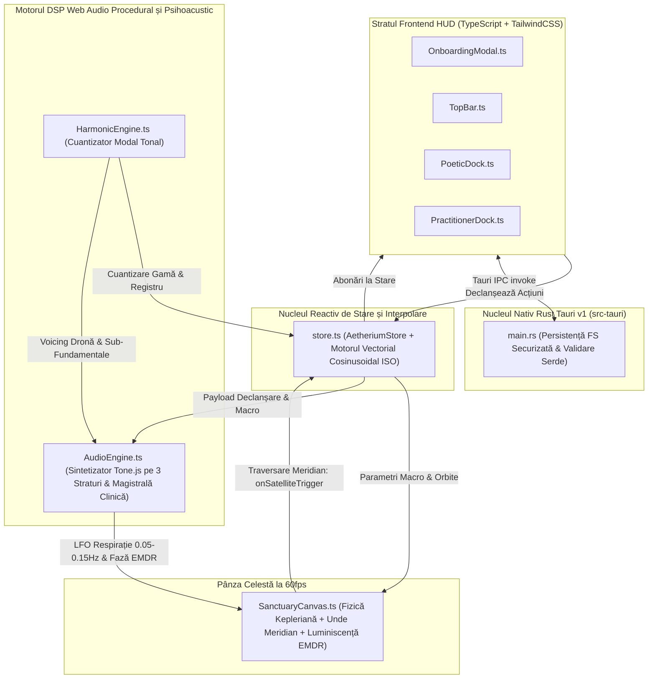

# AETHERIUM

**Sanctuar Desktop de Muzică Ambientală Generativă și Meloterapie Receptivă**

> 🌐 **Limba / Language:** [**Română (`README.ro.md`)**](./README.ro.md) | [**English (`README.md`)**](./README.md)

Aetherium este o aplicație desktop nativă, gratuită, open-source și ultra-ușoară pentru **macOS**, **Windows** și **Linux**. Sintetizează în timp real peisaje sonore ambientale și clinice continue, care nu se repetă niciodată—fără a necesita pregătire muzicală, conexiune la internet sau fișiere audio externe.

Aplicația este concepută pentru două categorii distincte de utilizatori:
- **Solo Explorer (Explorator Individual)**: Utilizatori de zi cu zi care caută autoreglare emoțională și nervoasă, concentrare profundă, relaxare contemplativă sau somn odihnitor.
- **Practitioner / Guide (Practician / Ghid Clinic)**: Psihologi, psihiatri, terapeuți EMDR și meloterapeuți care utilizează meloterapia receptivă, ancorarea somatică și reglarea emoțională ghidată în cabinet.

---

## Cuprins

1. [Partea I: Pentru Ascultători și Practicieni (Fără Cunoștințe Tehnice)](#partea-i-pentru-ascultători-și-practicieni-fără-cunoștințe-tehnice)
   - [Cum se Descarcă și Instalează](#1-cum-se-descarcă-și-instalează)
   - [Alegerea Spațiului: Solo Explorer vs. Practitioner / Guide](#2-alegerea-spațiului-solo-explorer-vs-practitioner--guide)
2. [Partea II: Arhitectură Tehnică, Fluxul Semnalului DSP și Modele Matematice](#partea-ii-arhitectură-tehnică-fluxul-semnalului-dsp-și-modele-matematice)
   - [Privire de Ansamblu asupra Arhitecturii Sistemului](#1-privire-de-ansamblu-asupra-arhitecturii-sistemului)
   - [Fizica Orbitală Kepleriană și Detecția Declanșării la Meridian](#2-fizica-orbitală-kepleriană-și-detecția-declanșării-la-meridian)
   - [Motorul de Cuantizare Armonică și Morfing Modal](#3-motorul-de-cuantizare-armonică-și-morfing-modal)
   - [Graful DSP Web Audio Procedural Multi-Strat și Psihoacustic](#4-graful-dsp-web-audio-procedural-multi-strat-și-psihoacustic)
   - [Procesarea DSP a Suitei Clinice și Interpolarea Vectorială a Principiului ISO](#5-procesarea-dsp-a-suitei-clinice-și-interpolarea-vectorială-a-principiului-iso)
   - [Pipeline-ul Procedural de Randare Atmosferică 2D](#6-pipeline-ul-procedural-de-randare-atmosferică-2d)
   - [Backend-ul Nativ Rust / Tauri v1 și Optimizarea Binarelor](#7-backend-ul-nativ-rust--tauri-v1-și-optimizarea-binarelor)
3. [Partea III: Pentru Dezvoltatori (Compilarea din Codul Sursă)](#partea-iii-pentru-dezvoltatori-compilarea-din-codul-sursă)

---

# Partea I: Pentru Ascultători și Practicieni (Fără Cunoștințe Tehnice)

**Nu** aveți nevoie de unelte de programare sau de cunoștințe tehnice pentru a folosi Aetherium.

## 1. Cum se Descarcă și Instalează

1. Accesați pagina [**Releases (Versiuni)**](../../releases) a acestui depozit pe GitHub.
2. Sub cea mai recentă versiune, deschideți secțiunea **Assets** și descărcați kitul de instalare potrivit pentru sistemul dumneavoastră:
   - **macOS (Apple Silicon M1 / M2 / M3 / M4):** Descărcați `Aetherium_..._aarch64.dmg`
   - **macOS (Mac cu procesor Intel):** Descărcați `Aetherium_..._x64.dmg`
     - *Sfat la prima lansare pe macOS:* Deschideți fișierul `.dmg` și trageți **Aetherium** în dosarul **Applications**. Dacă macOS Gatekeeper afișează un mesaj privind un dezvoltator neidentificat la prima deschidere, faceți **Click-Dreapta (sau Control-Click) pe `Aetherium.app` → selectați Open (Deschide)**.
   - **Windows (Windows 10 / 11):** Descărcați `Aetherium_..._x64-setup.exe` (sau `.msi`) și faceți dublu-click pentru instalare.
     - *Sfat la prima lansare pe Windows:* Dacă apare fereastra Windows SmartScreen, apăsați pe **More info (Mai multe informații) → Run anyway (Rulează oricum)**.
   - **Linux (Ubuntu / Debian / Mint / Fedora):** Descărcați `Aetherium_..._amd64.AppImage` (oferiți permisiuni de execuție cu `chmod +x Aetherium*.AppImage` și faceți dublu-click) sau instalați pachetul Debian (`sudo dpkg -i Aetherium_..._amd64.deb`).

---

## 2. Alegerea Spațiului: Solo Explorer vs. Practitioner / Guide

La deschiderea aplicației Aetherium, o fereastră minimalistă vă invită să vă alegeți spațiul de lucru (**Select Your Space**). Puteți comuta oricând între cele două moduri folosind butonul de tip pastilă din colțul din dreapta-sus.

### Modul A: Solo Explorer (Sanctuarul Personal)

Conceput pentru o interacțiune tactilă pură, fără distrageri tehnice:

1. **Activarea Sunetului:** Apăsați butonul **Awaken Audio** din panoul inferior pentru a porni drona armonică fundamentală.
2. **Pânza Orbitală (Sanctuary Canvas):**
   - **Nucleul Central (The Core):** Pulsează lent în centrul ecranului, într-un ritm de respirație de 10–15 secunde. Tragerea ușoară a Nucleului spre stânga sau spre dreapta modifică balansul stereo între boxe sau căști.
   - **Sateliții Armonici (Până la 12 Noduri):** Faceți click oriunde în spațiul întunecat din jurul Nucleului pentru a plasa un satelit pe orbită.
   - **Meridianul de la Ora 12 (`XII`):** De fiecare dată când un satelit traversează linia luminoasă verticală situată deasupra Nucleului, acesta declanșează o notă muzicală cuantizată matematic într-o gamă armonică consonantă—este imposibil să generați o notă falsă sau stridentă.
   - **Distanța Controlează Înălțimea Notei și Viteza Orbitală:**
     - **Orbitele Interioare (Aproape de Nucleu):** Se rotesc mai rapid și redau note cristaline, în registrul acut (Octavele 4–5).
     - **Orbitele Medii:** Redau armonii calde în registrul mediu (Octavele 3–4).
     - **Orbitele Exterioare (Departe de Nucleu):** Se deplasează lent și redau note profunde de violoncel și bas (Octavele 2–3).
   - **Modelarea și Dizolvarea Sateliților:** Trageți orice satelit mai aproape sau mai departe de Nucleu pentru a-i schimba registrul muzical; faceți **click-dreapta** (sau **țineți apăsat lung**) pe un satelit pentru a-l dizolva în particule.
3. **Docul Poetic Inferior (Poetic Dock):**
   - **Seeds (Semințe Sonore / Preseturi):** Alegeți între *Rain on Felt* (pian intim cu ciocănele de pâslă), *Deep Drift* (pad spațial vast în modul Lydian), *Subterranean* (dronă profundă, telurică) sau *Solar Wind* (consonanță caldă, luminoasă).
   - **Luminance (*Shadow ↔ Light / Umbră ↔ Lumină*):** Transformă treptat gama muzicală de la minor melancolic (*Aeolian / Phrygian*), trecând prin *Dorian* și *Major 9th*, până la deschiderea cosmică a modului *Lydian*, deschizând simultan strălucirea timbrală.
   - **Fog (*Clarity ↔ Mist / Claritate ↔ Ceață*):** Învăluie sunetul într-o reverberație amplă și atenuează frecvențele înalte într-o ceață difuză.
   - **Viscosity (*Crystalline ↔ Dense / Cristalin ↔ Dens*):** Încetinește viteza orbitală a sateliților, alungește urmele luminoase de pe ecran și transformă atacul notelor în creșteri lente și catifelate.
   - **Nostalgia (*Pristine ↔ Worn / Pur ↔ Patinat*):** Adaugă căldura benzii magnetice analogice, o ușoară fluctuație a înălțimii sunetului (*wow & flutter*), o textură discretă de ploaie/vinil și o granulație vizuală de film sepia.
   - **Rarity (*Present ↔ Silence / Prezență ↔ Liniște*):** Controlează probabilitatea ca o traversare a Meridianului să rămână în tăcere în loc să redea o notă, oferind muzicii spațiu de respirație.
   - **Fade to Silence (Temporizator de Somn):** Selectați `15m`, `30m` sau `60m` lângă pictograma semilunii pentru ca Aetherium să reducă treptat volumul până la liniște deplină.

---

### Modul B: Practitioner / Guide (Suita Clinică)

Comutarea în modul **Practitioner / Guide** dezvăluie panoul lateral pliabil **Practitioner Suite** în partea dreaptă a ecranului, proiectat special pentru cabinete de psihoterapie, psihiatrie, reglare somatică și ședințe EMDR:

1. **Vocal-Range Carving (Sculptare Acustică pentru Dialog — Dialogue Mode)**
   - *Problema Clinică:* Muzica ambientală obișnuită ocupă banda de frecvențe $400\text{ Hz} - 2.5\text{ kHz}$—exact același spectru ca vocea umană—forțând terapeutul și pacientul să vorbească peste muzică și provocând oboseală cognitivă.
   - *Cum Funcționează:* Când modul **Dialogue ON** este activ, Aetherium sculptează un „buzunar acustic" lin, centrat la $1100\text{ Hz}$ (ajustabil de la `0 dB` până la `-12 dB`). Încăperea rămâne învăluită în căldura frecvențelor sub-bas ($40\text{–}150\text{ Hz}$) și în aerul armonicelor superioare ($>3.5\text{ kHz}$), în timp ce dialogul terapeutic rămâne perfect clar și fără efort.

2. **Automated ISO-Principle Session Arc (Vector Pacing — Arcul Terapeutic ISO)**
   - *Principiul Clinic:* În meloterapia receptivă, **Principiul ISO** prevede că muzica reglează cel mai eficient sistemul nervos atunci când oglindește mai întâi starea emoțională/autonomă inițială a pacientului, ghidându-l apoi treptat către o stare țintă de reglare.
   - *Cum Funcționează:*
     1. Alegeți durata ședinței (`20m`, `45m`, `50m` ora terapeutică standard sau `60m`).
     2. Selectați **Faza 1 — Mirroring (Starea Inițială)** pentru a oglindi starea cu care sosește pacientul (*High Agitation / Tension*, *Melancholic / Heavy* sau *Dissociated / Flat*).
     3. Selectați **Faza 2 — Co-Regulation (Starea Țintă la 75% din durată)** (*Parasympathetic Rest / Safe Grounding* sau *Warm Openness*).
     4. Apăsați **Start Session Arc**. Aetherium interpolează automat gama muzicală, ritmul orbital, ceața reverberantă și căldura armonică pe parcursul ședinței—iar în **ultimele 10% din timp (Faza 3 — Re-Orientation)** crește blând luminozitatea și claritatea, astfel încât pacientul să părăsească cabinetul ancorat și vigilent, nu excesiv sedat.

3. **Bilateral Grounding (Stimulare Bilaterală EMDR / Panoramare Somatică)**
   - *Cum Funcționează:* Activați **Bilateral Grounding** pentru a deplasa lin vocile armonice și un puls ritmic delicat între canalul audio **Stâng** și cel **Drept** (cu viteză reglabilă de la `0.2 Hz` pentru meditație lentă până la `1.5 Hz` pentru procesare activă, și lățime stereo de la `0%` la `100%`).
   - *Urmărire Vizuală + Auditivă:* O luminiscență calmă oscilează sincron pe marginile stângă și dreaptă ale ecranului (însoțită de un reper luminos orizontal), permițând pacientului să urmărească ritmul bilateral auditiv, vizual sau multimodal.

4. **Ancoră Somatică Sub-Bas ($40\text{–}60\text{ Hz}$) și Antrenare Binaurală Theta ($6\text{ Hz}$)**
   - **Somatic Sub-Bass Anchor ($40\text{–}60\text{ Hz}$):** Amplifică o undă sinusoidală sub-fundamentală pură și caldă, creând o senzație fizică liniștitoare de împământare în încăpere sau în căști pentru pacienții anxioși sau disociați.
   - **Binaural Theta (`100Hz L / 106Hz R`):** Pentru ședințele cu căști, activarea **6Hz ON** trimite $100\text{ Hz}$ în urechea stângă și $106\text{ Hz}$ în urechea dreaptă, generând o bătaie binaurală Theta de $6\text{ Hz}$ mascată organic sub peisajul sonor.
   - **Preseturi de Ședință:** Salvați configurațiile clinice în sloturi locale rapide sau exportați/importați fișiere `.aether.json`.

---

# Partea II: Arhitectură Tehnică, Fluxul Semnalului DSP și Modele Matematice

Această secțiune detaliază **ce** implementează Aetherium la nivel intern și **cum** este proiectat fiecare subsistem.

## 1. Privire de Ansamblu asupra Arhitecturii Sistemului

Aetherium este construit ca o aplicație desktop nativă, bazată pe evenimente, împărțită în patru straturi decuplate:



---

## 2. Fizica Orbitală Kepleriană și Detecția Declanșării la Meridian

Implementat în [`src/canvas/SanctuaryCanvas.ts`](./src/canvas/SanctuaryCanvas.ts), spațiul vizual înlocuiește cronologiile liniare de tip DAW cu un sistem de coordonate gravitațional polar centrat pe **Atractorul Central (Nucleul)**.

### Geometria Orbitei Eliptice
Fiecare nod satelit $i \in [1, 12]$ păstrează o semiaxă mare normalizată $a \in [0.14, 0.94]$, excentricitatea orbitală $e \in [0.04, 0.24]$, argumentul periapsului $\omega$ și anomalia adevărată $\theta \in [-\pi, \pi]$. Distanța radială instantanee față de Nucleu este calculată prin ecuația secțiunii conice kepleriene:

$$r(\theta) = \frac{a(1 - e^2)}{1 + e \cos(\theta - \omega)}$$

### Viteza Unghiulară și Amortizarea prin Vâscozitate
Conform legilor a II-a și a III-a ale lui Kepler, viteza unghiulară este invers proporțională cu $r^{3/2}$ (calibrată la exponentul $1.42$ pentru ergonomie tactilă) și modulată atât de parametrul macro **Viscosity** ($v \in [0, 1]$), cât și de **Multiplicatorul de Ritm al Principiului ISO** ($m_{\text{iso}}$):

$$\frac{d\theta}{dt} = \frac{k_0}{\max(0.14, r(\theta))^{1.42}} \cdot (1 - 0.68v) \cdot m_{\text{iso}}$$

unde $k_0 = 0.22\text{ rad/s}$. Sateliții interiori ($a \approx 0.14$) parcurg orbite rapide, în timp ce sateliții exteriori ($a \approx 0.90$) plutesc în cicluri meditative ample.

### Detecția Traversării Meridianului Nord
**Meridianul (`XII`)** este poziționat la $\theta_{\text{meridian}} = -\frac{\pi}{2}$ (ora 12 Nord). La fiecare cadru de animație $\Delta t$, dacă unghiul anterior $\theta_{t-1}$ și unghiul actualizat $\theta_t$ satisfac condiția:

$$\theta_{t-1} < -\frac{\pi}{2} \le \theta_t$$

pânza apelează `store.emitSatelliteTrigger(sat)`, care emite un eveniment DOM `CustomEvent('onSatelliteTrigger', { detail })` pe `window`, notifică motorul audio, iluminează filamentul Meridianului și generează o undă radială de luminiscență în punctul de intersecție.

---

## 3. Motorul de Cuantizare Armonică și Morfing Modal

Implementat în [`src/audio/HarmonicEngine.ts`](./src/audio/HarmonicEngine.ts) cu ajutorul bibliotecii de teorie muzicală `Tonal`, Aetherium garantează că nicio interacțiune nu poate produce disonanțe aspre.

### Mașina de Stări Modale Condusă de Luminance
Parametrul macro `Luminance` ($L \in [0.0, 1.0]$) acționează ca un vector continuu de luminozitate armonică ce transformă atât notele gamei active, cât și acordul de 4 note al Dronei Centrale în patru zone psihoacustice:

| Interval Luminance | ID Zonă Armonică | Mod Muzical și Voicing | Profil Emoțional / Psihoacustic |
| :--- | :--- | :--- | :--- |
| **`0.00 – 0.25`** | `shadow-aeolian` | **Aeolian (Minor Natural)** sau **Phrygian** (`C` / `D`) | Umbră melancolică profundă, introspecție |
| **`0.25 – 0.50`** | `wistful-dorian` | **Modul Dorian** cu extensii $\text{min7}$ și $\text{add9}$ | Căldură intimă, nostalgică (sexta mare doriană + nona) |
| **`0.50 – 0.75`** | `floating-maj9` | **Pentatonică Majoră / $\text{Maj9}$** (`1, 9, 3, 5, 6, 7`) | Consonanță deschisă, plutitoare, reconfortantă |
| **`0.75 – 1.00`** | `cosmic-lydian` | **Modul Lydian** ($\sharp 4 / \sharp 11$ cvarta mărită) | Expansiune cosmică, imponderabilitate |

### Maparea Razei Orbitale la Registrul de Octavă
Când un satelit este creat sau tras la o nouă rază orbitală $a$, `HarmonicEngine.mapRadiusToOctave(a)` îi atribuie registrul psihoacustic corespunzător:
- **Orbite Interioare ($0.14 \le a < 0.38$):** Registrul acut cristalin (**Octavele 4–5**).
- **Orbite Medii ($0.38 \le a < 0.68$):** Registrul mediu cald (**Octavele 3–4**).
- **Orbite Exterioare ($0.68 \le a \le 0.94$):** Registrul grav de violoncel și bas (**Octavele 2–3**).

### Rarity (Poarta Entropică Probabilistă)
Înainte ca o traversare a Meridianului să declanșeze sinteza audio, `store.emitSatelliteTrigger` evaluează o probă Bernoulli în raport cu glisorul `Rarity` ($R \in [0, 1]$):

$$P(\text{liniște}) = 0.90 \cdot R$$

Când poarta entropică omite o notă (`silencedByRarity = true`), motorul audio păstrează tăcerea în timp ce satelitul emite o pulsație vizuală discretă (`· silence`), oferind compoziției spațiu natural de respirație.

---

## 4. Graful DSP Web Audio Procedural Multi-Strat și Psihoacustic

Implementat în [`src/audio/AudioEngine.ts`](./src/audio/AudioEngine.ts) folosind **Web Audio API** și **Tone.js**, întregul sunet este generat procedural în timp real (zero fișiere `.mp3` sau `.wav`). Toate tranzițiile parametrilor folosesc `rampTo(valoare, 0.2)` (netezire pe $200\text{ ms}$) pentru a elimina complet zgomotul de cuantizare (*zipper noise*).

```mermaid
flowchart LR
    subgraph LAYERS["3 Straturi Procedurale de Sinteză"]
        direction TB
        LA["Stratul A: Drona Centrală\nPad 3x FatSawtooth + Sub-Sinus -12dB\n→ Filtru LPF 24dB (LFO Respirație 0.05-0.15Hz)"]
        LB["Stratul B: Vocile Sateliților\n1. Pian cu Pâslă FM\n2. Pad Spațial AM cu Atac Lent (1.5-4s)"]
        LC["Stratul C: Textură Organică\nZgomot Roz + Brun\n→ Filtru Trecere-Bandă Baleiat la 0.065Hz"]
    end

    subgraph PAN["Etapa Spațială și EMDR"]
        CP["Panoramare Nucleu (coreOffset.x)"]
        BP["Panoramare Bilaterală EMDR\n(LFO Sinusoidal 0.2-1.5Hz + Puls Armonic)"]
    end

    subgraph MACRO_BUS["Magistrala DSP Poetic Macro"]
        WS["WaveShaper Soft-Clip Nostalgia\n(curbă de saturație tanh)"]
        TD["Delay Bandă Nostalgia\n(LFO Wow & Flutter 0.8Hz)"]
        PP["PingPongDelay Stereo\n(feedback Viscosity + Fog)"]
        RV["Reverb Freeverb + Convoluție\n(dezintegrare efectivă 2s - 18s)"]
        LPF["Filtru Master Low-Pass Fog\n(atenuare 12kHz → 1.2kHz)"]
    end

    subgraph CLINICAL_BUS["Magistrala Clinică și de Protecție Master"]
        VC["Filtru EQ Vocal-Range Carving\n(1100Hz, Q=0.7, 0 până la -12dB)"]
        SUB["Sub-Bas Somatic (Sinus 40-60Hz)\n& Theta Binaural (100Hz L / 106Hz R)"]
        MG["Master Gain & Atenuare Somn"]
        CMP["Compresor Master\n(-15dB, 3.2:1)"]
        LIM["Limitator Brickwall (-1.0 dBFS)"]
    end

    LA --> CP --> WS
    LB --> BP --> WS
    WS --> TD --> PP --> RV --> LPF
    LC --> LPF
    LPF --> VC --> MG
    SUB -->|Ocolește Filtrul Vocal| MG
    MG --> CMP --> LIM --> OUT(("Ieșire Audio"))
```



### Detaliile Straturilor de Sinteză
1. **Stratul A — Drona Centrală (The Core Drone):**
   - **Fundația Pad:** `Tone.PolySynth(Tone.Synth)` configurat cu 3 oscilatoare dinte-de-fierăstrău detunate (`type: 'fatsawtooth'`, `spread: 24 cenți`) care redau acordul modal activ de 4 note.
   - **Ancora Sub-Fundamentală:** Oscilator `Tone.Synth` dedicat (`type: 'sine'`, atenuat la `-12 dB` față de pad) fixat pe fundamentala gravă (`C1`, `D1`, `F1`, `G1`).
   - **Modulația Respiratorie a Filtrului:** Ambele surse trec printr-un filtru trece-jos rezonant de `24 dB/oct` (`Q = 2.1`) a cărui frecvență de tăiere este modulată de un LFO sinusoidal foarte lent (`0.05 Hz` – `0.15 Hz`, ciclu respirator de 6,6 până la 20 secunde). Faza instantanee a acestui LFO este expusă prin `audioEngine.getBreathingModulation(timeSec)`, sincronizând pulsația vizuală a Nucleului cu respirația acustică.
2. **Stratul B — Vocile cu Dublu Timbru ale Sateliților:**
   - **Vocea 1 (Pian cu Pâslă / Ciupitură Intimă):** `Tone.FMSynth` polifonic (`harmonicity: 2.0`, `modulationIndex: 1.2 + 1.4 * luminance`, modulator triunghiular cu atenuare rapidă) ce redă atacul catifelat al ciocănelului de pâslă urmat de o rezonanță lemnoasă caldă (`attack: 0.015s – 0.28s`, `release: 1.8s – 6.5s`).
   - **Vocea 2 (Pad Spațial Cristalin):** `Tone.AMSynth` polifonic (`harmonicity: 1.5`, purtătoare dublă `fatsine`) cu atac lent fără clic (`1.5s – 4.0s` scalat de `viscosity`) și eliberare lungă (`3.0s – 8.5s`).
3. **Stratul C — Generatorul de Textură Organică:**
   - Generatoare procedurale `Tone.Noise('pink')` și `Tone.Noise('brown')` modelate de un filtru trece-bandă (`Q = 1.8`) baleiat continuu între `240 Hz` și `1,180 Hz` de un LFO la `0.065 Hz`, emulând ploaia îndepărtată pe pâslă, vântul prin pini sau căldura suprafeței de vinil.

### Ecuațiile DSP ale Parametrilor Macro Poetici
- **Fog ($F \in [0, 1]$):** Controlează mixajul umed/uscat și dimensiunea camerei pentru rețeaua `Tone.Freeverb` + `Tone.Reverb` (extinzând coada de reverberație de la $2\text{s}$ la $18\text{s}$) și coboară exponențial frecvența de tăiere a filtrului Master Low-Pass de la $12\text{ kHz}$ până la $1.2\text{ kHz}$:

$$f_{\text{fog}}(F, L) = \text{clamp}\left(12000 \cdot \left(\frac{1200}{12000}\right)^F \cdot (0.75 + 0.50L),\ 950,\ 14000\right)\text{ Hz}$$

- **Nostalgia ($N \in [0, 1]$):**
  1. Modulează timpul unei linii de întârziere (`12 ms`) cu un LFO sinusoidal la `0.8 Hz` cu $\pm 3.8N\text{ ms}$ pentru a reproduce fluctuația analogică *wow & flutter*.
  2. Alimentează un saturator neliniar (*waveshaper*) bazat pe tangenta hiperbolică în 1024 de puncte:

$$y(x) = \frac{\tanh(k \cdot x)}{\tanh(k)}, \quad k = 0.6 + 2.2N$$

---

## 5. Procesarea DSP a Suitei Clinice și Interpolarea Vectorială a Principiului ISO

### 1. Sculptarea Acustică a Spectrului Vocal (Dialogue Mode)
Inserează un filtru parametric `Tone.Filter` (`type: 'peaking'`, `frequency: 1100 Hz`, `Q: 0.7`, `gain` reglabil între `0 dB` și `-12 dB`) pe magistrala master. Deoarece factorul de calitate $Q = 0.7$ acoperă aproximativ două octave în jurul valorii de $1.1\text{ kHz}$, filtrul eliberează spectrul fundamental și formantic al vorbirii umane ($400\text{ Hz} – 2.5\text{ kHz}$), păstrând intacte frecvențele sub-bas ($40\text{–}150\text{ Hz}$) și armonicele înalte ($>3.5\text{ kHz}$).

### 2. Motorul de Interpolare Vectorială Cosinusoidală pe Porțiuni (Principiul ISO)
Implementat în [`evaluateIsoSessionArc`](./src/state/store.ts) din `src/state/store.ts`, cronologia ședinței normalizează timpul scurs în $p = \frac{t_{\text{scurs}}}{t_{\text{total}}} \in [0, 1]$ și interpolează vectorul clinic cu 6 dimensiuni $\mathbf{V} = [\text{luminance}, \text{fog}, \text{viscosity}, \text{nostalgia}, \text{rarity}, m_{\text{iso}}]^T$ folosind interpolarea cosinusoidală netedă:

$$\mu(t) = \frac{1 - \cos(\pi t)}{2}, \quad \mathbf{V}(t) = (1 - \mu(t))\mathbf{V}_a + \mu(t)\mathbf{V}_b$$

- **Faza 1 — Oglindire ($0.00 \le p < 0.22$) & Tranziția Fazei 2 ($0.22 \le p < 0.75$):** Morfează lin de la starea inițială a pacientului $\mathbf{V}_{\text{start}}$ către starea țintă de co-reglare $\mathbf{V}_{\text{target}}$ la $p = 0.75$.
- **Platoul de Consolidare a Co-Reglării ($0.75 \le p < 0.90$):** Menține starea reglată $\mathbf{V}_{\text{target}}$ stabilă pentru ancorare parasimpatică profundă.
- **Faza 3 — Re-Orientare ($0.90 \le p \le 1.00$):** Interpolează pe ultimele $10\%$ din ședință către $\mathbf{V}_{\text{reorient}}$ (`luminance: 0.84`, `fog: 0.22`, `viscosity: 0.36`, `orbitalSpeed: 0.96`), readucând pacientul într-o stare de prezență clară și ancorată.

### 3. Stimularea Bilaterală (EMDR / Panoramare Somatică)
 Direcționează vocile sateliților și un oscilator armonic dedicat (`emdrPulseOsc`, acordat pe fundamentala gamei în Octava 3 și modulat în amplitudine la $2 f_{\text{emdr}}$) printr-un nod `Tone.Panner` sinusoidal:

$$\text{Pan}(t) = W \cdot \sin(2\pi f_{\text{emdr}} t), \quad f_{\text{emdr}} \in [0.2, 1.5]\text{ Hz},\ W \in [0, 1]$$

Simultan, `SanctuaryCanvas.renderBilateralVisualGrounding` interoghează `audioEngine.getBilateralPanPosition(t)` la 60fps pentru a randa coloanele luminoase laterale și sfera orizontală de urmărire oculară în fază exactă cu sunetul.

### 4. Sub-Basul Somatic ($40\text{–}60\text{ Hz}$) și Antrenarea Binaurală Theta ($6\text{ Hz}$)
- **Ancora Somatică Sub-Bas:** Un oscilator sinusoidal pur (`somaticSubOsc`) acordat pe sub-fundamentala seminței active în banda $43.65\text{ Hz} – 55.0\text{ Hz}$ (`F1 = 43.65 Hz`, `G1 = 49.0 Hz`, `A1 = 55.0 Hz`), conectat direct la `masterGain` (ocolind filtrul vocal de la $1100\text{ Hz}$).
- **Antrenarea Binaurală Theta:** Două oscilatoare sinusoidale pure panoramate complet (`binauralLeftOsc` la $100\text{ Hz}$, `pan = -1.0`; `binauralRightOsc` la $106\text{ Hz}$, `pan = +1.0`), generând o bătaie binaurală perceptivă de $6\text{ Hz}$ (unde cerebrale Theta) în timpul audiției în căști.

---

## 6. Pipeline-ul Procedural de Randare Atmosferică 2D

Pentru a menține executabilul nativ compact și eficient pe plăci grafice integrate, `SanctuaryCanvas.ts` implementează efecte atmosferice procedurale în HTML5 2D Canvas accelerat hardware:
- **Morfingul Paletei Cromatice prin Luminance:** Nuanțele HSL primare și de accent sunt interpolate continuu de la indigo-ardezie profund ($234^\circ$), trecând prin cyan ($193^\circ$), până la chihlimbar solar cald ($42^\circ$).
- **Buffere Inelare pentru Urmele de Vâscozitate:** Fiecare satelit menține un istoric de coordonate a cărui lungime variază dinamic cu `viscosity` ($14$ până la $86$ de puncte), randat cu atenuare alfa pătratică și blur Gaussian (`ctx.filter = blur(...)`) controlat de `fog`.
- **Granulație Procedurală de Film și Fluctuație de Bandă (Nostalgia):** O textură RGBA offscreen de $180 \times 180$ pixeli este pre-generată la pornire și proiectată peste scenă cu deplasări sub-cadru și o vignetă radială sepia, în timp ce pozițiile sateliților primesc o micro-oscilație deterministă proporțională cu `nostalgia`.

---

## 7. Backend-ul Nativ Rust / Tauri v1 și Optimizarea Binarelor

Implementat în [`src-tauri/src/main.rs`](./src-tauri/src/main.rs) și [`src-tauri/Cargo.toml`](./src-tauri/Cargo.toml):
- **Persistență Validată prin Schemă:** Comenzile native Tauri `save_constellation_json` și `load_constellation_json` validează fiecare fișier de preset în raport cu structura `ConstellationFilePayload` prin `serde` și `serde_json` înainte de scrierea sau citirea din directorul AppData al sistemului de operare (`$APPDATA/constellations/*.aether.json`).
- **Amprentă Binară Minimă:** Profilul Rust `[profile.release]` activează optimizarea la nivel de linkare (`lto = true`), o singură unitate de generare de cod (`codegen-units = 1`), optimizarea dimensiunii (`opt-level = "z"`), eliminarea simbolurilor de depanare (`strip = true`) și `panic = "abort"`, rezultând un executabil nativ de câțiva megabyți care utilizează WebView-ul nativ al sistemului de operare.

---

# Partea III: Pentru Dezvoltatori (Compilarea din Codul Sursă)

## 1. Cerințe Preliminare

Pentru a compila Aetherium din codul sursă, instalați:
1. **Node.js** (v18+ sau v20+ LTS) și `npm`
2. **Toolchain-ul Rust** (`rustup` / `cargo` stable): [https://rustup.rs](https://rustup.rs)
3. **Dependențele de Sistem Tauri v1:**
   - **macOS:** Xcode Command Line Tools (`xcode-select --install`)
   - **Ubuntu / Debian Linux:**
     ```bash
     sudo apt-get update
     sudo apt-get install -y libwebkit2gtk-4.0-dev libasound2-dev build-essential curl wget file libssl-dev libgtk-3-dev libayatana-appindicator3-dev librsvg2-dev
     ```
   - **Windows:** Microsoft Visual Studio C++ Build Tools și WebView2 Runtime (preinstalat pe Windows 10/11).

## 2. Comenzi de Compilare și Rulare

Sunt necesare doar două comenzi pentru a instala dependențele și a compila pachetul nativ de instalare:

```bash
# 1. Instalează dependențele TypeScript, Vite, Tone.js, Tonal și Tauri CLI
npm install

# 2. Compilează aplicația nativă optimizată (.dmg, .msi/.exe sau .AppImage/.deb)
npm run tauri build
```

Pentru dezvoltare cu reîncărcare în timp real (hot-reload):

```bash
# Rulează în fereastra nativă de dezvoltare Tauri
npm run tauri dev

# Sau rulează interfața într-un browser web la http://localhost:1420
npm run dev
```

## 3. Structura Fișierelor din Depozit

```text
Aetherium/
├── .github/workflows/release.yml   # Matrice CI/CD multi-platformă (macOS, Linux, Windows)
├── README.md                       # Documentație (Engleză / English)
├── README.ro.md                    # Documentație (Română)
├── src-tauri/                      # Backend Rust Tauri v1 & configurație nativă fereastră/FS
│   ├── Cargo.toml                  # Profil Rust optimizat pentru dimensiune minimă (opt-level = "z", LTO)
│   ├── tauri.conf.json             # Fereastră 1280x800 & permisiuni securizate FS/Dialog
│   └── src/main.rs                 # Comenzi native pentru salvarea/încărcarea constelațiilor JSON
└── src/
    ├── main.ts                     # Punctul de intrare al aplicației
    ├── state/store.ts              # Store reactiv & motorul de interpolare vectorială a Principiului ISO
    ├── audio/
    │   ├── HarmonicEngine.ts       # Cuantizare modală Luminance & maparea registrelor orbitale
    │   └── AudioEngine.ts          # Sintetizator Tone.js pe 3 straturi + magistrala DSP clinică
    ├── canvas/
    │   └── SanctuaryCanvas.ts      # Fizică orbitală kepleriană la 60fps, Meridian & luminiscență EMDR
    └── components/
        ├── OnboardingModal.ts      # Fereastra modală de selecție a spațiului la lansare
        ├── TopBar.ts               # Comutator de mod, telemetrie & export/import JSON
        ├── PoeticDock.ts           # Selector Seeds, cele 4 glisoare Macro, Rarity & Temporizator Somn
        └── PractitionerDock.ts     # Suita clinică laterală pliabilă (Dialogue EQ, Arc ISO, EMDR)
```

---

## Licență

Distribuit sub **Licența MIT**. Dezvoltat cu grijă de **Voidwave Lab**.
