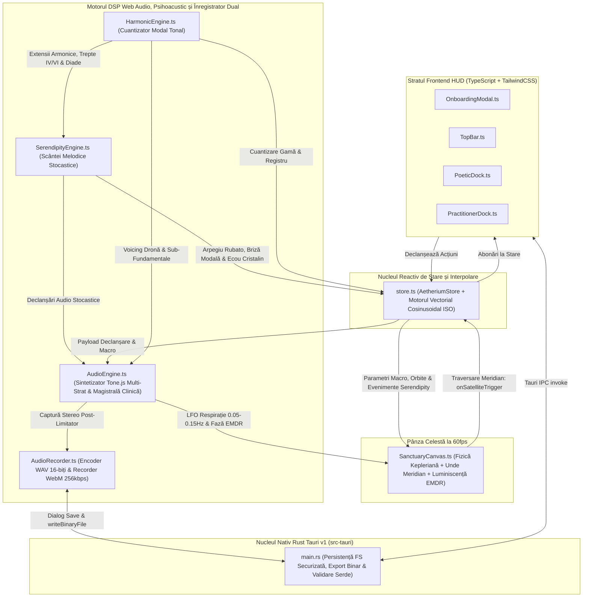

# AETHERIUM

**Sanctuar Desktop de Muzică Ambientală Generativă și Meloterapie Receptivă**

[](./LICENSE)
[](#partea-iv-etică-credite-open-source-bibliografie-academică-și-licența-gnu-gpl-v30)
[-cyan.svg)](#4-graful-dsp-web-audio-procedural-multi-strat-și-psihoacustic)

> 🌐 **Limba / Language:** [**Română (`README.ro.md`)**](./README.ro.md) | [**English (`README.md`)**](./README.md)

Aetherium este o aplicație desktop nativă, gratuită, open-source și ultra-ușoară pentru **macOS**, **Windows** și **Linux**. Sintetizează în timp real peisaje sonore ambientale și clinice continue, care nu se repetă niciodată—fără a necesita pregătire muzicală, conexiune la internet sau fișiere audio externe.

Aplicația este concepută pentru două categorii distincte de utilizatori:
- **Solo Explorer (Explorator Individual)**: Utilizatori de zi cu zi care caută autoreglare emoțională și nervoasă, concentrare profundă, relaxare contemplativă sau somn odihnitor.
- **Practitioner / Guide (Practician / Ghid Clinic)**: Psihologi, psihiatri, terapeuți EMDR și meloterapeuți care utilizează meloterapia receptivă, ancorarea somatică și reglarea emoțională ghidată în cabinet.

---

## Cuprins

1. [Partea I: Pentru Ascultători și Practicieni (Fără Cunoștințe Tehnice)](#partea-i-pentru-ascultători-și-practicieni-fără-cunoștințe-tehnice)
   - [Cum se Descarcă și Instalează](#1-cum-se-descarcă-și-instalează)
   - [Alegerea Spațiului: Solo Explorer vs. Practitioner / Guide](#2-alegerea-spațiului-solo-explorer-vs-practitioner--guide)
2. [Partea II: Arhitectură Tehnică, Fluxul Semnalului DSP și Modele Matematice](#partea-ii-arhitectură-tehnică-fluxul-semnalului-dsp-și-modele-matematice)
   - [Privire de Ansamblu asupra Arhitecturii Sistemului](#1-privire-de-ansamblu-asupra-arhitecturii-sistemului)
   - [Fizica Orbitală Kepleriană și Detecția Declanșării la Meridian](#2-fizica-orbitală-kepleriană-și-detecția-declanșării-la-meridian)
   - [Motorul de Cuantizare Armonică și Morfing Modal](#3-motorul-de-cuantizare-armonică-și-morfing-modal)
   - [Graful DSP Web Audio Procedural Multi-Strat și Psihoacustic](#4-graful-dsp-web-audio-procedural-multi-strat-și-psihoacustic)
   - [Motorul Serendipity: Scântei Melodice Stocastice și Fenomene Efemere](#5-motorul-serendipity-scântei-melodice-stocastice-și-fenomene-efemere)
   - [Procesarea DSP a Suitei Clinice și Interpolarea Vectorială a Principiului ISO](#6-procesarea-dsp-a-suitei-clinice-și-interpolarea-vectorială-a-principiului-iso)
   - [Înregistrator Audio de Calitate Studio și Export Clinic „Take-Home" (`.wav` & `.webm`)](#7-înregistrator-audio-de-calitate-studio-și-export-clinic-take-home-wav--webm)
   - [Pipeline-ul Procedural de Randare Atmosferică 2D](#8-pipeline-ul-procedural-de-randare-atmosferică-2d)
   - [Backend-ul Nativ Rust / Tauri v1 și Optimizarea Binarelor](#9-backend-ul-nativ-rust--tauri-v1-și-optimizarea-binarelor)
3. [Partea III: Pentru Dezvoltatori (Compilarea din Codul Sursă)](#partea-iii-pentru-dezvoltatori-compilarea-din-codul-sursă)
4. [Partea IV: Etică, Credite Open-Source, Bibliografie Academică și Licența GNU GPL v3.0](#partea-iv-etică-credite-open-source-bibliografie-academică-și-licența-gnu-gpl-v30)
   - [A. Filosofia Bunurilor Comune (Commons) și Atribuirea Etică AI](#a-filosofia-bunurilor-comune-commons-și-atribuirea-etică-ai)
   - [B. Ecosistemul Open-Source și Linkuri Directe către Depozite](#b-ecosistemul-open-source-și-linkuri-directe-către-depozite)
   - [C. Bibliografie Fundamentală (DSP, Muzică Generativă și Psihoacustică)](#c-bibliografie-fundamentală-dsp-muzică-generativă-și-psihoacustică)
   - [D. Declinarea Responsabilității Clinice și Terapeutice](#d-declinarea-responsabilității-clinice-și-terapeutice)
   - [E. Garanția „Liber pentru Totdeauna" (Rezumat GNU GPL v3.0)](#e-garanția-liber-pentru-totdeauna-rezumat-gnu-gpl-v30)

---

# Partea I: Pentru Ascultători și Practicieni (Fără Cunoștințe Tehnice)

**Nu** aveți nevoie de unelte de programare sau de cunoștințe tehnice pentru a folosi Aetherium.

## 1. Cum se Descarcă și Instalează

1. Accesați pagina [**Releases (Versiuni)**](../../releases) a acestui depozit pe GitHub.
2. Sub cea mai recentă versiune, deschideți secțiunea **Assets** și descărcați kitul de instalare potrivit pentru sistemul dumneavoastră:
   - **macOS (Apple Silicon M1 / M2 / M3 / M4):** Descărcați `Aetherium_..._aarch64.dmg`
   - **macOS (Mac cu procesor Intel):** Descărcați `Aetherium_..._x64.dmg`
     - *Sfat la prima lansare pe macOS:* Deschideți fișierul `.dmg` și trageți **Aetherium** în dosarul **Applications**. Dacă macOS Gatekeeper afișează un mesaj privind un dezvoltator neidentificat la prima deschidere, faceți **Click-Dreapta (sau Control-Click) pe `Aetherium.app` → selectați Open (Deschide)**.
   - **Windows (Windows 10 / 11):** Descărcați `Aetherium_..._x64-setup.exe` (sau `.msi`) și faceți dublu-click pentru instalare.
     - *Sfat la prima lansare pe Windows:* Dacă apare fereastra Windows SmartScreen, apăsați pe **More info (Mai multe informații) → Run anyway (Rulează oricum)**.
   - **Linux (Ubuntu / Debian / Mint / Fedora):** Descărcați `Aetherium_..._amd64.AppImage` (oferiți permisiuni de execuție cu `chmod +x Aetherium*.AppImage` și faceți dublu-click) sau instalați pachetul Debian (`sudo dpkg -i Aetherium_..._amd64.deb`).

---

## 2. Alegerea Spațiului: Solo Explorer vs. Practitioner / Guide

La deschiderea aplicației Aetherium, o fereastră minimalistă vă invită să vă alegeți spațiul de lucru (**Select Your Space**). Puteți comuta oricând între cele două moduri folosind butonul de tip pastilă din colțul din dreapta-sus.

### Modul A: Solo Explorer (Sanctuarul Personal)

Conceput pentru o interacțiune tactilă pură, fără distrageri tehnice:

1. **Activarea Sunetului:** Apăsați butonul **Awaken Audio** din panoul inferior pentru a porni drona armonică fundamentală.
2. **Pânza Orbitală (Sanctuary Canvas):**
   - **Nucleul Central (The Core):** Pulsează lent în centrul ecranului, într-un ritm de respirație de 10–15 secunde. Tragerea ușoară a Nucleului spre stânga sau spre dreapta modifică balansul stereo între boxe sau căști.
   - **Sateliții Armonici (Până la 12 Noduri):** Faceți click oriunde în spațiul întunecat din jurul Nucleului pentru a plasa un satelit pe orbită.
   - **Meridianul de la Ora 12 (`XII`):** De fiecare dată când un satelit traversează linia luminoasă verticală situată deasupra Nucleului, acesta declanșează o notă muzicală cuantizată matematic într-o gamă armonică consonantă—este imposibil să generați o notă falsă sau stridentă.
   - **Distanța Controlează Înălțimea Notei și Viteza Orbitală:**
     - **Orbitele Interioare (Aproape de Nucleu):** Se rotesc mai rapid și redau note cristaline, în registrul acut (Octavele 4–5).
     - **Orbitele Medii:** Redau armonii calde în registrul mediu (Octavele 3–4).
     - **Orbitele Exterioare (Departe de Nucleu):** Se deplasează lent și redau note profunde de violoncel și bas (Octavele 2–3).
   - **Modelarea și Dizolvarea Sateliților:** Trageți orice satelit mai aproape sau mai departe de Nucleu pentru a-i schimba registrul muzical; faceți **click-dreapta** (sau **țineți apăsat lung**) pe un satelit pentru a-l dizolva în particule.
3. **Docul Poetic Inferior (Poetic Dock):**
   - **8 Semințe Sonore Procedurale (Seeds):**
     - *Rain on Felt* (pian intim cu ciocănele de pâslă)
     - *Deep Drift* (pad spațial vast în modul Lydian)
     - *Subterranean* (dronă profundă, telurică)
     - *Solar Wind* (consonanță caldă, luminoasă)
     - *Midnight Vinyl* (atmosferă nocturnă Lo-Fi / Future Garage cu acorduri Rhodes FM filtrate sub `600 Hz`, sub-bas la `45–65 Hz` și micro-impulsuri stocastice de vinil/ploaie la `2.5 kHz`)
     - *Singing Bowls* (boluri tibetane sintetizate modal prin 4 parțiale inarmonice `[1.0, 2.756, 5.404, 8.933]`, atac de `0.08s` și rezonanță de `14s`)
     - *Cathedral Choir* (sinteză vocală formantică prin 3 filtre trece-bandă paralele ce morfează continuu între vocalele `'Ahh'` `[700, 1220, 2600 Hz]` și `'Ooo'` `[450, 800, 2830 Hz]`)
     - *Bowed Glass & Strings* (coarde post-rock / cinematice cu atac lent de `3.0s`, rezonanță simpatică Karplus-Strong, banc de filtre pentru corpul de lemn și vibrato organic la `4.5 Hz`)
   - **Luminance (*Shadow ↔ Light / Umbră ↔ Lumină*):** Transformă treptat gama muzicală de la minor melancolic (*Aeolian / Phrygian*), trecând prin *Dorian* și *Major 9th*, până la deschiderea cosmică a modului *Lydian*, deschizând simultan strălucirea timbrală.
   - **Fog (*Clarity ↔ Mist / Claritate ↔ Ceață*):** Învăluie sunetul într-o reverberație amplă și atenuează frecvențele înalte într-o ceață difuză.
   - **Viscosity (*Crystalline ↔ Dense / Cristalin ↔ Dens*):** Încetinește viteza orbitală a sateliților, alungește urmele luminoase de pe ecran și transformă atacul notelor în creșteri lente și catifelate.
   - **Nostalgia (*Pristine ↔ Worn / Pur ↔ Patinat*):** Adaugă căldura benzii magnetice analogice, o ușoară fluctuație a înălțimii sunetului (*wow & flutter*), o textură discretă de ploaie/vinil și o granulație vizuală de film sepia.
   - **Rarity (*Present ↔ Silence / Prezență ↔ Liniște*):** Controlează probabilitatea ca o traversare a Meridianului să rămână în tăcere în loc să redea o notă, oferind muzicii spațiu de respirație.
   - **Serendipity (*Stillness ↔ Sparks / Nemiscare ↔ Scântei*):** Previne obișnuința auditivă (*habituation*) prin apariția unor micro-evenimente muzicale și vizuale blânde la intervale neregulate (la fiecare 8–25 secunde)—precum un *Arpegiu Rubato* însoțit de o cometă luminoasă pe cerul exterior, o *Briză Modală* ce transpune temporar fundamentala pe subdominantă (`IV`) sau submediantă (`VI`) odată cu o undă de auroră dinspre Nucleu, ori un *Ecou Cristalin* în Octava 5. Setați la `0% (Stillness)` pentru predictibilitate pură sau creșteți spre `100% (Sparks)` pentru un sanctuar viu, în continuă evoluție.
   - **Capture Sanctuary (Înregistrare Live a Sesiunii):** Apăsați butonul **Capture Sanctuary** de lângă butonul Play/Mute pentru a înregistra în timp real peisajul sonor generativ. În timpul înregistrării, butonul este înconjurat de un halou pulsatoriu chihlimbar/rubiniu și afișează cronometrul `MM:SS`. La apăsarea **Stop Capture**, se deschide fereastra **Save Recorded Sanctuary Audio**, de unde puteți salva sesiunea cu un nume de fișier poetic generat automat (de ex. `Aetherium_RainOnFelt_2026-10-26.wav`) în două formate:
     - **Lossless Studio (`.wav`):** Audio PCM stereo pe 16 biți fără pierderi, cu fade-in cosinusoidal automat de 2 secunde și fade-out cosinusoidal de 3 secunde, astfel încât fișierul să poată rula în buclă continuă pe telefon fără clicuri.
     - **Mobile Compact (`.webm`):** Flux audio comprimat la `256 kbps`, ideal pentru stocare mobilă eficientă sau partajare rapidă.
   - **Fade to Silence (Temporizator de Somn):** Selectați `15m`, `30m` sau `60m` lângă pictograma semilunii pentru ca Aetherium să reducă treptat volumul până la liniște deplină.

---

### Modul B: Practitioner / Guide (Suita Clinică)

Comutarea în modul **Practitioner / Guide** dezvăluie panoul lateral pliabil **Practitioner Suite** în partea dreaptă a ecranului, proiectat special pentru cabinete de psihoterapie, psihiatrie, reglare somatică și ședințe EMDR:

1. **Vocal-Range Carving (Sculptare Acustică pentru Dialog — Dialogue Mode)**
   - *Problema Clinică:* Muzica ambientală obișnuită ocupă banda de frecvențe $400\text{ Hz} - 2.5\text{ kHz}$—exact același spectru ca vocea umană—forțând terapeutul și pacientul să vorbească peste muzică și provocând oboseală cognitivă.
   - *Cum Funcționează:* Când modul **Dialogue ON** este activ, Aetherium sculptează un „buzunar acustic" lin, centrat la $1100\text{ Hz}$ (ajustabil de la `0 dB` până la `-12 dB`). Încăperea rămâne învăluită în căldura frecvențelor sub-bas ($40\text{–}150\text{ Hz}$) și în aerul armonicelor superioare ($>3.5\text{ kHz}$), în timp ce dialogul terapeutic rămâne perfect clar și fără efort.

2. **Automated ISO-Principle Session Arc (Vector Pacing — Arcul Terapeutic ISO)**
   - *Principiul Clinic:* În meloterapia receptivă, **Principiul ISO** prevede că muzica reglează cel mai eficient sistemul nervos atunci când oglindește mai întâi starea emoțională/autonomă inițială a pacientului, ghidându-l apoi treptat către o stare țintă de reglare.
   - *Cum Funcționează:*
     1. Alegeți durata ședinței (`20m`, `45m`, `50m` ora terapeutică standard sau `60m`).
     2. Selectați **Faza 1 — Mirroring (Starea Inițială)** pentru a oglindi starea cu care sosește pacientul (*High Agitation / Tension*, *Melancholic / Heavy* sau *Dissociated / Flat*).
     3. Selectați **Faza 2 — Co-Regulation (Starea Țintă la 75% din durată)** (*Parasympathetic Rest / Safe Grounding* sau *Warm Openness*).
     4. Apăsați **Start Session Arc**. Aetherium interpolează automat gama muzicală, ritmul orbital, ceața reverberantă și căldura armonică pe parcursul ședinței—menținând parametrul **Serendipity** la un nivel scăzut (`5%`) în timpul fazei parasimpatice profunde și crescându-l treptat (`35%`) împreună cu luminozitatea și claritatea în **ultimele 10% din timp (Faza 3 — Re-Orientation)**, pentru a trezi blând atenția pacientului la finalul terapiei.

3. **Bilateral Grounding (Stimulare Bilaterală EMDR / Panoramare Somatică)**
   - *Cum Funcționează:* Activați **Bilateral Grounding** pentru a deplasa lin vocile armonice și un puls ritmic delicat între canalul audio **Stâng** și cel **Drept** (cu viteză reglabilă de la `0.2 Hz` pentru meditație lentă până la `1.5 Hz` pentru procesare activă, și lățime stereo de la `0%` la `100%`).
   - *Urmărire Vizuală + Auditivă:* O luminiscență calmă oscilează sincron pe marginile stângă și dreaptă ale ecranului (însoțită de un reper luminos orizontal), permițând pacientului să urmărească ritmul bilateral auditiv, vizual sau multimodal.
   - *Garda de Siguranță Clinică (Blocare Automată Serendipity în EMDR):* Ori de câte ori modul Bilateral EMDR este activat, Aetherium blochează automat **Serendipity** la `0%` (anulând orice comete sau schimbări modale), astfel încât niciun stimul aleatoriu să nu distragă pacientul de la urmărirea bilaterală.

4. **Ancoră Somatică Sub-Bas ($40\text{–}60\text{ Hz}$) și Antrenare Binaurală Theta ($6\text{ Hz}$)**
   - **Somatic Sub-Bass Anchor ($40\text{–}60\text{ Hz}$):** Amplifică o undă sinusoidală sub-fundamentală pură și caldă, creând o senzație fizică liniștitoare de împământare în încăpere sau în căști pentru pacienții anxioși sau disociați.
   - **Binaural Theta (`100Hz L / 106Hz R`):** Pentru ședințele cu căști, activarea **6Hz ON** trimite $100\text{ Hz}$ în urechea stângă și $106\text{ Hz}$ în urechea dreaptă, generând o bătaie binaurală Theta de $6\text{ Hz}$ mascată organic sub peisajul sonor.
   - **Preseturi de Ședință:** Salvați configurațiile clinice în sloturi locale rapide sau exportați/importați fișiere `.aether.json`.

5. **Patient Take-Home Anchor (Ancoră Audio Terapeutică „Take-Home")**
   - *Utilitate Clinică:* Pacienții beneficiază adesea de posibilitatea de a asculta acasă exact ambianța sonoră co-creată și reglată în timpul ședinței de terapie, ca ancoră de autoreglare între programări.
   - *Cum Funcționează:* În secțiunea **5. Patient Take-Home Anchor**, apăsați **`Capture 3 Min Loop`**, **`Capture 5 Min Anchor`** sau **`Capture 10 Min Rest`**. Aetherium pornește automat o înregistrare temporizată a stării terapeutice active (incluzând Vocal-Range Carving, panoramarea bilaterală EMDR sau sub-basul somatic, dacă sunt activate), afișează o bară calmă de progres (cu opțiunea de finalizare anticipată **Finish & Export Now**), aplică automat fade-in cosinusoidal de 2 secunde și fade-out de 3 secunde și deschide dialogul de salvare în format **Lossless Studio (`.wav`)** sau **Mobile Compact (`.webm` · ușor de trimis pe WhatsApp/Email)** la finalizarea temporizatorului.

---

# Partea II: Arhitectură Tehnică, Fluxul Semnalului DSP și Modele Matematice

Această secțiune detaliază **ce** implementează Aetherium la nivel intern și **cum** este proiectat fiecare subsistem.

## 1. Privire de Ansamblu asupra Arhitecturii Sistemului

Aetherium este construit ca o aplicație desktop nativă, bazată pe evenimente, împărțită în patru straturi decuplate:



---

## 2. Fizica Orbitală Kepleriană și Detecția Declanșării la Meridian

Implementat în [`src/canvas/SanctuaryCanvas.ts`](./src/canvas/SanctuaryCanvas.ts), spațiul vizual înlocuiește cronologiile liniare de tip DAW cu un sistem de coordonate gravitațional polar centrat pe **Atractorul Central (Nucleul)**.

### Geometria Orbitei Eliptice
Fiecare nod satelit $i \in [1, 12]$ păstrează o semiaxă mare normalizată $a \in [0.14, 0.94]$, excentricitatea orbitală $e \in [0.04, 0.24]$, argumentul periapsului $\omega$ și anomalia adevărată $\theta \in [-\pi, \pi]$. Distanța radială instantanee față de Nucleu este calculată prin ecuația secțiunii conice kepleriene:

$$r(\theta) = \frac{a(1 - e^2)}{1 + e \cos(\theta - \omega)}$$

### Viteza Unghiulară și Amortizarea prin Vâscozitate
Conform legilor a II-a și a III-a ale lui Kepler, viteza unghiulară este invers proporțională cu $r^{3/2}$ (calibrată la exponentul $1.42$ pentru ergonomie tactilă) și modulată atât de parametrul macro **Viscosity** ($v \in [0, 1]$), cât și de **Multiplicatorul de Ritm al Principiului ISO** ($m_{\text{iso}}$):

$$\frac{d\theta}{dt} = \frac{k_0}{\max(0.14, r(\theta))^{1.42}} \cdot (1 - 0.68v) \cdot m_{\text{iso}}$$

unde $k_0 = 0.22\text{ rad/s}$. Sateliții interiori ($a \approx 0.14$) parcurg orbite rapide, în timp ce sateliții exteriori ($a \approx 0.90$) plutesc în cicluri meditative ample.

### Detecția Traversării Meridianului Nord
**Meridianul (`XII`)** este poziționat la $\theta_{\text{meridian}} = -\frac{\pi}{2}$ (ora 12 Nord). La fiecare cadru de animație $\Delta t$, dacă unghiul anterior $\theta_{t-1}$ și unghiul actualizat $\theta_t$ satisfac condiția:

$$\theta_{t-1} < -\frac{\pi}{2} \le \theta_t$$

pânza apelează `store.emitSatelliteTrigger(sat)`, care emite un eveniment DOM `CustomEvent('onSatelliteTrigger', { detail })` pe `window`, notifică motorul audio, iluminează filamentul Meridianului și generează o undă radială de luminiscență în punctul de intersecție.

---

## 3. Motorul de Cuantizare Armonică și Morfing Modal

Implementat în [`src/audio/HarmonicEngine.ts`](./src/audio/HarmonicEngine.ts) cu ajutorul bibliotecii de teorie muzicală `Tonal`, Aetherium garantează că nicio interacțiune nu poate produce disonanțe aspre.

### Mașina de Stări Modale Condusă de Luminance
Parametrul macro `Luminance` ($L \in [0.0, 1.0]$) acționează ca un vector continuu de luminozitate armonică ce transformă atât notele gamei active, cât și acordul de 4 note al Dronei Centrale în patru zone psihoacustice:

| Interval Luminance | ID Zonă Armonică | Mod Muzical și Voicing | Profil Emoțional / Psihoacustic |
| :--- | :--- | :--- | :--- |
| **`0.00 – 0.25`** | `shadow-aeolian` | **Aeolian (Minor Natural)** sau **Phrygian** (`C` / `D`) | Umbră melancolică profundă, introspecție |
| **`0.25 – 0.50`** | `wistful-dorian` | **Modul Dorian** cu extensii $\text{min7}$ și $\text{add9}$ | Căldură intimă, nostalgică (sexta mare doriană + nona) |
| **`0.50 – 0.75`** | `floating-maj9` | **Pentatonică Majoră / $\text{Maj9}$** (`1, 9, 3, 5, 6, 7`) | Consonanță deschisă, plutitoare, reconfortantă |
| **`0.75 – 1.00`** | `cosmic-lydian` | **Modul Lydian** ($\sharp 4 / \sharp 11$ cvarta mărită) | Expansiune cosmică, imponderabilitate |

### Maparea Razei Orbitale la Registrul de Octavă
Când un satelit este creat sau tras la o nouă rază orbitală $a$, `HarmonicEngine.mapRadiusToOctave(a)` îi atribuie registrul psihoacustic corespunzător:
- **Orbite Interioare ($0.14 \le a < 0.38$):** Registrul acut cristalin (**Octavele 4–5**).
- **Orbite Medii ($0.38 \le a < 0.68$):** Registrul mediu cald (**Octavele 3–4**).
- **Orbite Exterioare ($0.68 \le a \le 0.94$):** Registrul grav de violoncel și bas (**Octavele 2–3**).

### Rarity (Poarta Entropică Probabilistă)
Înainte ca o traversare a Meridianului să declanșeze sinteza audio, `store.emitSatelliteTrigger` evaluează o probă Bernoulli în raport cu glisorul `Rarity` ($R \in [0, 1]$):

$$P(\text{liniște}) = 0.90 \cdot R$$

Când poarta entropică omite o notă (`silencedByRarity = true`), motorul audio păstrează tăcerea în timp ce satelitul emite o pulsație vizuală discretă (`· silence`), oferind compoziției spațiu natural de respirație.

---

## 4. Graful DSP Web Audio Procedural Multi-Strat și Psihoacustic

Implementat în [`src/audio/AudioEngine.ts`](./src/audio/AudioEngine.ts) folosind **Web Audio API** și **Tone.js**, întregul sunet este generat procedural în timp real (zero fișiere `.mp3` sau `.wav`). Toate tranzițiile parametrilor folosesc `rampTo(valoare, 0.2)` (netezire pe $200\text{ ms}$) pentru a elimina complet zgomotul de cuantizare (*zipper noise*).

```mermaid
flowchart LR
    subgraph LAYERS["3 Straturi Procedurale de Sinteză"]
        direction TB
        LA["Stratul A: Drona Centrală\nPad 3x FatSawtooth + Sub-Sinus -12dB\n→ Filtru LPF 24dB (LFO Respirație 0.05-0.15Hz)"]
        LB["Stratul B: Vocile Sateliților\n1. Pian cu Pâslă FM\n2. Pad Spațial AM cu Atac Lent (1.5-4s)"]
        LC["Stratul C: Textură Organică\nZgomot Roz + Brun\n→ Filtru Trecere-Bandă Baleiat la 0.065Hz"]
    end

    subgraph PAN["Etapa Spațială și EMDR"]
        CP["Panoramare Nucleu (coreOffset.x)"]
        BP["Panoramare Bilaterală EMDR\n(LFO Sinusoidal 0.2-1.5Hz + Puls Armonic)"]
    end

    subgraph MACRO_BUS["Magistrala DSP Poetic Macro"]
        WS["WaveShaper Soft-Clip Nostalgia\n(curbă de saturație tanh)"]
        TD["Delay Bandă Nostalgia\n(LFO Wow & Flutter 0.8Hz)"]
        PP["PingPongDelay Stereo\n(feedback Viscosity + Fog)"]
        RV["Reverb Freeverb + Convoluție\n(dezintegrare efectivă 2s - 18s)"]
        LPF["Filtru Master Low-Pass Fog\n(atenuare 12kHz → 1.2kHz)"]
    end

    subgraph CLINICAL_BUS["Magistrala Clinică și de Protecție Master"]
        VC["Filtru EQ Vocal-Range Carving\n(1100Hz, Q=0.7, 0 până la -12dB)"]
        SUB["Sub-Bas Somatic (Sinus 40-60Hz)\n& Theta Binaural (100Hz L / 106Hz R)"]
        MG["Master Gain & Atenuare Somn"]
        CMP["Compresor Master\n(-15dB, 3.2:1)"]
        LIM["Limitator Brickwall (-1.0 dBFS)"]
    end

    LA --> CP --> WS
    LB --> BP --> WS
    WS --> TD --> PP --> RV --> LPF
    LC --> LPF
    LPF --> VC --> MG
    SUB -->|Ocolește Filtrul Vocal| MG
    MG --> CMP --> LIM --> OUT(("Ieșire Audio"))
```



### Detaliile Straturilor de Sinteză
1. **Stratul A — Drona Centrală (The Core Drone):**
   - **Fundația Pad:** `Tone.PolySynth(Tone.Synth)` configurat cu 3 oscilatoare dinte-de-fierăstrău detunate (`type: 'fatsawtooth'`, `spread: 24 cenți`) care redau acordul modal activ de 4 note.
   - **Ancora Sub-Fundamentală:** Oscilator `Tone.Synth` dedicat (`type: 'sine'`, atenuat la `-12 dB` față de pad) fixat pe fundamentala gravă (`C1`, `D1`, `F1`, `G1`).
   - **Modulația Respiratorie a Filtrului:** Ambele surse trec printr-un filtru trece-jos rezonant de `24 dB/oct` (`Q = 2.1`) a cărui frecvență de tăiere este modulată de un LFO sinusoidal foarte lent (`0.05 Hz` – `0.15 Hz`, ciclu respirator de 6,6 până la 20 secunde). Faza instantanee a acestui LFO este expusă prin `audioEngine.getBreathingModulation(timeSec)`, sincronizând pulsația vizuală a Nucleului cu respirația acustică.
2. **Stratul B — 6 Motoare Procedurale pentru Vocile Sateliților:**
   - **Motorul 1 (Pian cu Pâslă / Ciupitură Intimă):** `Tone.FMSynth` polifonic (`harmonicity: 2.0`, `modulationIndex: 1.2 + 1.4 * luminance`, modulator triunghiular cu atenuare rapidă) ce redă atacul catifelat al ciocănelului de pâslă urmat de o rezonanță lemnoasă caldă (`attack: 0.015s – 0.28s`, `release: 1.8s – 6.5s`).
   - **Motorul 2 (Pad Spațial Cristalin):** `Tone.AMSynth` polifonic (`harmonicity: 1.5`, purtătoare dublă `fatsine`) cu atac lent fără clic (`1.5s – 4.0s` scalat de `viscosity`) și eliberare lungă (`3.0s – 8.5s`).
   - **Motorul 3 (Midnight Vinyl — Nocturnal Lo-Fi / Future Garage):** Acorduri FM de tip Rhodes (`harmonicity: 1.0`) trecute printr-un filtru trece-jos de `24 dB/oct` (`< 600 Hz`), însoțite de o dronă sub-bas la `55 Hz` (`45–65 Hz`) și un generator stocastic de micro-impulsuri filtrate la `2.5 kHz` (`Q = 3.4`) pentru textura de vinil și ploaie nocturnă.
   - **Motorul 4 (Singing Bowls — Sinteză Modală Inarmonică):** 4 bancuri paralele de oscilatoare sinusoidale acordate pe rapoartele modale metalice Euler-Bernoulli ($[1.000,\ 2.756,\ 5.404,\ 8.933] \times f_0$), cu atac de ciocănel de pâslă (`0.08s`) și dezintegrare rezonantă de `14.0s`.
   - **Motorul 5 (Cathedral Choir — Sinteză Vocală Formantică):** Trece drona și vocile corale prin 3 filtre trece-bandă paralele cu factor $Q$ ridicat ($F_1, F_2, F_3$) care morfează continuu între vocala `'Ahh'` ($[700\text{ Hz},\ 1220\text{ Hz},\ 2600\text{ Hz}]$) și vocala `'Ooo'` ($[450\text{ Hz},\ 800\text{ Hz},\ 2830\text{ Hz}]$).
   - **Motorul 6 (Bowed Glass & Strings — Post-Rock / Cinematic):** Combină coarde arcuite cu atac lent de `3.0s` (`fatsawtooth`/`triangle`) și modelare fizică Karplus-Strong (`Tone.PluckSynth`) trecute printr-un banc de rezonanță acustică a corpului de lemn ($250\text{ Hz}$, $520\text{ Hz}$, $1850\text{ Hz}$) cu vibrato organic la `4.5 Hz`.
3. **Stratul C — Generatorul de Textură Organică:**
   - Generatoare procedurale `Tone.Noise('pink')` și `Tone.Noise('brown')` modelate de un filtru trece-bandă (`Q = 1.8`) baleiat continuu între `240 Hz` și `1,180 Hz` de un LFO la `0.065 Hz`, emulând ploaia îndepărtată pe pâslă, vântul prin pini sau căldura suprafeței de vinil.

### Ecuațiile DSP ale Parametrilor Macro Poetici
- **Fog ($F \in [0, 1]$):** Controlează mixajul umed/uscat și dimensiunea camerei pentru rețeaua `Tone.Freeverb` + `Tone.Reverb` (extinzând coada de reverberație de la $2\text{s}$ la $18\text{s}$) și coboară exponențial frecvența de tăiere a filtrului Master Low-Pass de la $12\text{ kHz}$ până la $1.2\text{ kHz}$:

$$f_{\text{fog}}(F, L) = \text{clamp}\left(12000 \cdot \left(\frac{1200}{12000}\right)^F \cdot (0.75 + 0.50L),\ 950,\ 14000\right)\text{ Hz}$$

- **Nostalgia ($N \in [0, 1]$):**
  1. Modulează timpul unei linii de întârziere (`12 ms`) cu un LFO sinusoidal la `0.8 Hz` cu $\pm 3.8N\text{ ms}$ pentru a reproduce fluctuația analogică *wow & flutter*.
  2. Alimentează un saturator neliniar (*waveshaper*) bazat pe tangenta hiperbolică în 1024 de puncte:

$$y(x) = \frac{\tanh(k \cdot x)}{\tanh(k)}, \quad k = 0.6 + 2.2N$$

---

## 5. Motorul Serendipity: Scântei Melodice Stocastice și Fenomene Efemere

Implementat în [`src/audio/SerendipityEngine.ts`](./src/audio/SerendipityEngine.ts), [`src/audio/HarmonicEngine.ts`](./src/audio/HarmonicEngine.ts) și [`src/canvas/SanctuaryCanvas.ts`](./src/canvas/SanctuaryCanvas.ts), modulul **Serendipity** ($S \in [0.0, 1.0]$) previne obișnuința auditivă în timpul sesiunilor lungi, păstrând însă un caracter meditativ, non-intruziv.

### 1. Planificatorul Stocastic Scalat Invers
Când redarea este activă și $S_{\text{eff}} > 0.01$, `SerendipityEngine` calculează fereastra următoarei evaluări $[T_{\min}, T_{\max}]$ invers proporțional cu $S_{\text{eff}}$:

$$T_{\min}(S_{\text{eff}}) = 8.0 + 11.0(1 - S_{\text{eff}})\text{ s}, \quad T_{\max}(S_{\text{eff}}) = 12.0 + 13.0(1 - S_{\text{eff}})\text{ s}$$

La valori reduse ($S_{\text{eff}} \to 0.05$), evenimentele apar rar, la fiecare $18.5\text{–}24.4\text{ secunde}$; la nivelul maxim ($S_{\text{eff}} = 1.0$), evenimentele apar la fiecare $8.0\text{–}12.0\text{ secunde}$.

### 2. Evenimente Muzicale Ponderate și Corespondente Vizuale Efemere
La fiecare evaluare, o extragere aleatoare uniformă $u \sim \mathcal{U}(0, 1)$ selectează unul dintre cele trei fenomene:

| Tip Eveniment | Pondere | Implementare Muzicală și Psihoacustică | Fenomen Vizual Efemer pe Pânză (`SanctuaryCanvas.ts`) |
| :--- | :--- | :--- | :--- |
| **Evenimentul A: Arpegiu Rubato** | **60%** ($u < 0.60$) | Selectează $N \in \{3, 4, 5\}$ note din gama activă, favorizând extensiile calde (**Fundamentală, Cvintă, Septimă, Nonă, Undecimă** în **Octavele 4–5**). Le redă secvențial cu o temporizare rubato neliniară, în ușoară decelerare ($\Delta t_i = 350 + 430(i/(N-1))^{1.45} + \epsilon\text{ ms} \in [350, 900]\text{ ms}$) și velocitate delicată ($0.18\text{–}0.30$). | Generează o **Cometă / Stea Căzătoare** (`SerendipityComet`) care alunecă pe arcul exterior al pânzei ($0.84\text{–}1.02\ R_{\max}$). Coada luminoasă și nucleul cometei pulsează sincron cu fiecare notă a arpegiului, eliberând particule stelare etichetate cu numele notei. |
| **Evenimentul B: Briză Modală / Schimbare de Fundamentală** | **20%** ($0.60 \le u < 0.80$) | Transpune temporar Drona Centrală, sub-basul somatic și rădăcina de cuantizare pe **Subdominantă ($\text{IV}$)** sau **Submediantă ($\text{VI}$)** timp de $16\text{–}24\text{ secunde}$, revenind apoi lin la tonica de bază ($\text{I}$). | Generează o **Undă de Auroră** (`ModalAuroraRipple`) care se extinde radial dinspre Nucleul Central peste ceața de fundal, afișând indicatorul `MODAL BREEZE · IV / VI` sub Nucleu. |
| **Evenimentul C: Ecou Cristalin în Octava 5** | **20%** ($u \ge 0.80$) | Declanșează o diadă armonică cristalină (interval de **Cvintă** sau **Terță** în **Octava 5**) pe sintetizatorul dedicat `ghostShimmerSynth`, rutată **100% umed (wet)** prin magistrala de reverberație cu coadă lungă (`ghostShimmerReverb`, `decay: 9.5s`, `wet: 1.0`). | Deschide un **Halou Cristalin** (`GhostEchoHalo`) în bolta superioară a pânzei, care se dilată lent și se dizolvă în ceață. |

### 3. Gărzi de Siguranță Clinică în Modul Practician
- **Blocarea Automată în timpul EMDR Bilateral:** Ori de câte ori stimularea bilaterală (`emdrBilateralEnabled`) este activă în modul **Practitioner / Guide**, `store.getEffectiveSerendipity()` fixează $S_{\text{eff}} = 0.0$, oprește orice arpegiu în curs și readuce imediat fundamentala la tonica $\text{I}$, prevenind orice distragere a atenției vizuale sau auditive.
- **Dozarea în Arcul Terapeutic ISO:** În timpul ședințelor automate bazate pe Principiul ISO (`evaluateIsoSessionArc`), parametrul `serendipity` este menținut la `0.05` (`5%`) pe toată durata **Fazei 2 de Co-Reglare parasimpatică** ($0.22 \le p < 0.90$) și este crescut cosinusoidal până la `0.35` (`35%`) în ultimele 10% (**Faza 3 de Re-Orientare**, $0.90 \le p \le 1.00$), stimulând blând re-ancorarea pacientului la finalul ședinței.

---

## 6. Procesarea DSP a Suitei Clinice și Interpolarea Vectorială a Principiului ISO

### 1. Sculptarea Acustică a Spectrului Vocal (Dialogue Mode)
Inserează un filtru parametric `Tone.Filter` (`type: 'peaking'`, `frequency: 1100 Hz`, `Q: 0.7`, `gain` reglabil între `0 dB` și `-12 dB`) pe magistrala master. Deoarece factorul de calitate $Q = 0.7$ acoperă aproximativ două octave în jurul valorii de $1.1\text{ kHz}$, filtrul eliberează spectrul fundamental și formantic al vorbirii umane ($400\text{ Hz} – 2.5\text{ kHz}$), păstrând intacte frecvențele sub-bas ($40\text{–}150\text{ Hz}$) și armonicele înalte ($>3.5\text{ kHz}$).

### 2. Motorul de Interpolare Vectorială Cosinusoidală pe Porțiuni (Principiul ISO)
Implementat în [`evaluateIsoSessionArc`](./src/state/store.ts) din `src/state/store.ts`, cronologia ședinței normalizează timpul scurs în $p = \frac{t_{\text{scurs}}}{t_{\text{total}}} \in [0, 1]$ și interpolează vectorul clinic cu 6 dimensiuni $\mathbf{V} = [\text{luminance}, \text{fog}, \text{viscosity}, \text{nostalgia}, \text{rarity}, m_{\text{iso}}]^T$ folosind interpolarea cosinusoidală netedă:

$$\mu(t) = \frac{1 - \cos(\pi t)}{2}, \quad \mathbf{V}(t) = (1 - \mu(t))\mathbf{V}_a + \mu(t)\mathbf{V}_b$$

- **Faza 1 — Oglindire ($0.00 \le p < 0.22$) & Tranziția Fazei 2 ($0.22 \le p < 0.75$):** Morfează lin de la starea inițială a pacientului $\mathbf{V}_{\text{start}}$ către starea țintă de co-reglare $\mathbf{V}_{\text{target}}$ la $p = 0.75$.
- **Platoul de Consolidare a Co-Reglării ($0.75 \le p < 0.90$):** Menține starea reglată $\mathbf{V}_{\text{target}}$ stabilă pentru ancorare parasimpatică profundă.
- **Faza 3 — Re-Orientare ($0.90 \le p \le 1.00$):** Interpolează pe ultimele $10\%$ din ședință către $\mathbf{V}_{\text{reorient}}$ (`luminance: 0.84`, `fog: 0.22`, `viscosity: 0.36`, `orbitalSpeed: 0.96`), readucând pacientul într-o stare de prezență clară și ancorată.

### 3. Stimularea Bilaterală (EMDR / Panoramare Somatică)
 Direcționează vocile sateliților și un oscilator armonic dedicat (`emdrPulseOsc`, acordat pe fundamentala gamei în Octava 3 și modulat în amplitudine la $2 f_{\text{emdr}}$) printr-un nod `Tone.Panner` sinusoidal:

$$\text{Pan}(t) = W \cdot \sin(2\pi f_{\text{emdr}} t), \quad f_{\text{emdr}} \in [0.2, 1.5]\text{ Hz},\ W \in [0, 1]$$

Simultan, `SanctuaryCanvas.renderBilateralVisualGrounding` interoghează `audioEngine.getBilateralPanPosition(t)` la 60fps pentru a randa coloanele luminoase laterale și sfera orizontală de urmărire oculară în fază exactă cu sunetul.

### 4. Sub-Basul Somatic ($40\text{–}60\text{ Hz}$) și Antrenarea Binaurală Theta ($6\text{ Hz}$)
- **Ancora Somatică Sub-Bas:** Un oscilator sinusoidal pur (`somaticSubOsc`) acordat pe sub-fundamentala seminței active în banda $43.65\text{ Hz} – 55.0\text{ Hz}$ (`F1 = 43.65 Hz`, `G1 = 49.0 Hz`, `A1 = 55.0 Hz`), conectat direct la `masterGain` (ocolind filtrul vocal de la $1100\text{ Hz}$).
- **Antrenarea Binaurală Theta:** Două oscilatoare sinusoidale pure panoramate complet (`binauralLeftOsc` la $100\text{ Hz}$, `pan = -1.0`; `binauralRightOsc` la $106\text{ Hz}$, `pan = +1.0`), generând o bătaie binaurală perceptivă de $6\text{ Hz}$ (unde cerebrale Theta) în timpul audiției în căști.

---

## 7. Înregistrator Audio de Calitate Studio și Export Clinic „Take-Home" (`.wav` & `.webm`)

Implementat în [`src/audio/AudioRecorder.ts`](./src/audio/AudioRecorder.ts) și conectat direct după nodul `masterLimiter` în [`src/audio/AudioEngine.ts`](./src/audio/AudioEngine.ts), Aetherium oferă un sistem dual de captură și export audio fără dependențe externe:

1. **Formatul A — Encoder `.wav` PCM Stereo pe 16 Biți Fără Pierderi (`encodeWAV`):**
   - Colectează eșantioane stereo `Float32Array` direct din magistrala master (la rata nativă `48.000 Hz` / `44.100 Hz` a `AudioContext`).
   - **Fade-In și Fade-Out Cosinusoidal Automat pentru Buclă Mobilă (`applySeamlessCosineFades`):** Înainte de codarea binară, aplicația aplică automat un **fade-in cosinusoidal de 2 secunde** la începutul înregistrării și un **fade-out cosinusoidal de 3 secunde** la final:
     $$g_{\text{in}}(n) = \frac{1 - \cos(\pi n / N_{\text{in}})}{2}, \quad g_{\text{out}}(m) = \frac{1 + \cos(\pi m / N_{\text{out}})}{2}$$
     unde $N_{\text{in}} = 2 f_s$ și $N_{\text{out}} = 3 f_s$. Acest profil garantează că fișierele exportate rulează în buclă continuă pe telefon fără clicuri sau discontinuități de fază.
   - **Generator de Antet RIFF/WAVE de 44 de Octeți:** `encodeWAV(leftChannel, rightChannel, sampleRate)` construiește antetul standard RIFF/WAVE de 44 de octeți (`fmt ` de `16` octeți, AudioFormat `1` PCM liniar, `2` canale stereo, `16` biți/eșantion) urmat de eșantioanele stereo intercalate `int16` little-endian într-un `Uint8Array`.
2. **Formatul B — Audio Mobil Compact (`.webm` / `.ogg` la `256.000 bps`):**
   - Direcționează semnalul master printr-un nod `MediaStreamAudioDestinationNode` înregistrat cu `MediaRecorder` la o rată de biți de `256000 bps` (`256 kbps`), generând fișiere compacte ușor de transmis pacienților prin WhatsApp sau Email.
3. **Dialog Nativ Tauri și Fallback pentru Browser:**
   - Generează automat nume de fișiere poetice prin `buildPoeticAudioFilename` (de ex. `Aetherium_RainOnFelt_2026-10-26.wav` sau `Aetherium_RainOnFelt_5MinAnchor_2026-10-26.wav`).
   - În aplicația nativă Tauri, apelează dialogul nativ `save` din `@tauri-apps/api/dialog` și scrie fișierul binar prin `writeBinaryFile` din `@tauri-apps/api/fs` (cu permisiuni pentru `$AUDIO/*`, `$DESKTOP/*`, `$DOWNLOAD/*`, `$DOCUMENT/*` și comanda Rust `save_audio_binary_file` ca rezervă). În modul de dezvoltare în browser (`npm run dev`), folosește descărcarea nativă `<a download>` `Blob`.

---

## 8. Pipeline-ul Procedural de Randare Atmosferică 2D

Pentru a menține executabilul nativ compact și eficient pe plăci grafice integrate, `SanctuaryCanvas.ts` implementează efecte atmosferice procedurale în HTML5 2D Canvas accelerat hardware:
- **Morfingul Paletei Cromatice prin Luminance:** Nuanțele HSL primare și de accent sunt interpolate continuu de la indigo-ardezie profund ($234^\circ$), trecând prin cyan ($193^\circ$), până la chihlimbar solar cald ($42^\circ$).
- **Buffere Inelare pentru Urmele de Vâscozitate:** Fiecare satelit menține un istoric de coordonate a cărui lungime variază dinamic cu `viscosity` ($14$ până la $86$ de puncte), randat cu atenuare alfa pătratică și blur Gaussian (`ctx.filter = blur(...)`) controlat de `fog`.
- **Fenomene Efemere Serendipity:** Randează comete multi-segment sincronizate la milisecundă cu notele arpegiilor rubato, unde radiale de auroră în timpul transpunerilor modale `IV`/`VI` și halouri cristaline în registrul supra-acut.
- **Granulație Procedurală de Film și Fluctuație de Bandă (Nostalgia):** O textură RGBA offscreen de $180 \times 180$ pixeli este pre-generată la pornire și proiectată peste scenă cu deplasări sub-cadru și o vignetă radială sepia, în timp ce pozițiile sateliților primesc o micro-oscilație deterministă proporțională cu `nostalgia`.

---

## 9. Backend-ul Nativ Rust / Tauri v1 și Optimizarea Binarelor

Implementat în [`src-tauri/src/main.rs`](./src-tauri/src/main.rs) și [`src-tauri/Cargo.toml`](./src-tauri/Cargo.toml):
- **Persistență Validată prin Schemă și Export Audio Binar:** Comenzile native Tauri `save_constellation_json` și `load_constellation_json` validează fiecare fișier de preset în raport cu structura `ConstellationFilePayload` prin `serde` și `serde_json` înainte de scrierea sau citirea din directorul AppData al sistemului de operare (`$APPDATA/constellations/*.aether.json`), iar `save_audio_binary_file` și `writeBinaryFile` gestionează salvarea fișierelor `.wav` și `.webm`.
- **Amprentă Binară Minimă:** Profilul Rust `[profile.release]` activează optimizarea la nivel de linkare (`lto = true`), o singură unitate de generare de cod (`codegen-units = 1`), optimizarea dimensiunii (`opt-level = "z"`), eliminarea simbolurilor de depanare (`strip = true`) și `panic = "abort"`, rezultând un executabil nativ de câțiva megabyți care utilizează WebView-ul nativ al sistemului de operare.

---

# Partea III: Pentru Dezvoltatori (Compilarea din Codul Sursă)

## 1. Cerințe Preliminare

Pentru a compila Aetherium din codul sursă, instalați:
1. **Node.js** (v18+ sau v20+ LTS) și `npm`
2. **Toolchain-ul Rust** (`rustup` / `cargo` stable): [https://rustup.rs](https://rustup.rs)
3. **Dependențele de Sistem Tauri v1:**
   - **macOS:** Xcode Command Line Tools (`xcode-select --install`)
   - **Ubuntu / Debian Linux:**
     ```bash
     sudo apt-get update
     sudo apt-get install -y libwebkit2gtk-4.0-dev libasound2-dev build-essential curl wget file libssl-dev libgtk-3-dev libayatana-appindicator3-dev librsvg2-dev
     ```
   - **Windows:** Microsoft Visual Studio C++ Build Tools și WebView2 Runtime (preinstalat pe Windows 10/11).

## 2. Comenzi de Compilare și Rulare

Sunt necesare doar două comenzi pentru a instala dependențele și a compila pachetul nativ de instalare:

```bash
# 1. Instalează dependențele TypeScript, Vite, Tone.js, Tonal și Tauri CLI
npm install

# 2. Compilează aplicația nativă optimizată (.dmg, .msi/.exe sau .AppImage/.deb)
npm run tauri build
```

Pentru dezvoltare cu reîncărcare în timp real (hot-reload):

```bash
# Rulează în fereastra nativă de dezvoltare Tauri
npm run tauri dev

# Sau rulează interfața într-un browser web la http://localhost:1420
npm run dev
```

## 3. Structura Fișierelor din Depozit

```text
Aetherium/
├── .github/workflows/release.yml   # Matrice CI/CD multi-platformă (macOS, Linux, Windows)
├── LICENSE                         # Licența Publică Generală GNU v3.0 (GPL-3.0-or-later)
├── README.md                       # Documentație (Engleză / English)
├── README.ro.md                    # Documentație (Română)
├── src-tauri/                      # Backend Rust Tauri v1 & configurație nativă fereastră/FS
│   ├── Cargo.toml                  # Profil Rust optimizat pentru dimensiune minimă (opt-level = "z", LTO)
│   ├── tauri.conf.json             # Fereastră 1280x800 & permisiuni securizate FS/Dialog
│   └── src/main.rs                 # Comenzi native pentru constelații JSON și export audio binar
└── src/
    ├── main.ts                     # Punctul de intrare al aplicației
    ├── state/store.ts              # Store reactiv, stare înregistrare & motorul Principiului ISO
    ├── audio/
    │   ├── HarmonicEngine.ts       # Cuantizare modală Luminance, transpuneri IV/VI & registre orbitale
    │   ├── SerendipityEngine.ts    # Arpegii rubato stocastice, brize modale & ecouri cristaline
    │   ├── AudioRecorder.ts        # Encoder WAV 16-biți (fade cosinusoidal 2s/3s) & Recorder WebM 256kbps
    │   └── AudioEngine.ts          # Sintetizator Tone.js multi-strat + magistrala DSP clinică
    ├── canvas/
    │   └── SanctuaryCanvas.ts      # Fizică kepleriană la 60fps, Meridian, comete, aurore & EMDR
    └── components/
        ├── AboutModal.ts           # Fereastra modală "ⓘ Ethics, Credits & Bibliography"
        ├── OnboardingModal.ts      # Fereastra modală de selecție a spațiului la lansare
        ├── TopBar.ts               # Comutator de mod, buton Etică/Bibliografie, telemetrie & JSON
        ├── PoeticDock.ts           # 8 Seeds, 6 glisoare Macro, Capture Sanctuary & Modal Export
        └── PractitionerDock.ts     # Suita clinică laterală (Dialogue EQ, Arc ISO, EMDR, Take-Home Anchor)
```

---

# Partea IV: Etică, Credite Open-Source, Bibliografie Academică și Licența GNU GPL v3.0

> 💡 *În aplicație, apăsați butonul **`ⓘ Ethics, Credits & Bibliography`** din bara superioară sau din ecranul inițial de selecție a spațiului pentru a consulta oricând aceste informații.*

## A. Filosofia Bunurilor Comune (Commons) și Atribuirea Etică AI

Deși direcția artistică, conceptul orbital keplerian neliniar, maparea psihoacustică și fluxurile de meloterapie receptivă ale proiectului **Aetherium** au fost concepute uman, implementarea tehnică a fost accelerată cu asistență AI antrenată pe munca colectivă a mii de dezvoltatori open-source, matematicieni, teoreticieni muzicali și ingineri de procesare a semnalului (DSP).

Deoarece acest sanctuar se sprijină pe decenii de cunoaștere umană partajată și cod open-source, publicarea Aetherium sub licența strict copyleft **GNU General Public License v3.0 (`GPL-3.0-or-later`)** reprezintă angajamentul nostru moral de a întoarce această lucrare patrimoniului comun—garantând **confidențialitate 100% offline**, **zero telemetrie**, **zero bariere comerciale** și imunitate permanentă împotriva închiderii proprietare.

---

## B. Ecosistemul Open-Source și Linkuri Directe către Depozite

Recunoștință profundă autorilor și comunităților din spatele proiectelor open-source care stau la baza Aetherium:

- [**Tauri** (`https://github.com/tauri-apps/tauri`)](https://github.com/tauri-apps/tauri) — Framework nativ multi-platformă construit în Rust.
- [**Tone.js** (`https://github.com/Tonejs/Tone.js`)](https://github.com/Tonejs/Tone.js) — Framework Web Audio pentru muzică interactivă și sinteză procedurală în timp real.
- [**Tonal** (`https://github.com/tonaljs/tonal`)](https://github.com/tonaljs/tonal) — Bibliotecă funcțională de teorie muzicală pentru game armonice, cuantizare modală și intervale.
- [**Vite** (`https://github.com/vitejs/vite`)](https://github.com/vitejs/vite) & [**TypeScript** (`https://github.com/microsoft/TypeScript`)](https://github.com/microsoft/TypeScript) — Unelte de compilare frontend și siguranță statică a tipurilor.
- [**Rust Language & Audio Ecosystem** (`https://www.rust-lang.org`)](https://www.rust-lang.org) — Fundație sigură pentru programarea de sistem.

---

## C. Bibliografie Fundamentală (DSP, Muzică Generativă și Psihoacustică)

### 1. Procesarea Digitală a Semnalului (DSP) și Sinteza prin Modelare Fizică
- **Karplus, K., & Strong, A. (1983).** *"Digital Synthesis of Plucked-String and Drum Timbres."* *Computer Music Journal*, 7(2), 43–55. *(Baza teoretică pentru sinteza coardelor ciupite și a harpei în Bowed Glass & Strings).*
- **Smith, J. O. (2010).** *Physical Audio Signal Processing: For Virtual Musical Instruments and Audio Effects.* W3K Publishing / CCRMA Stanford. *(Fundamentul pentru rețele de ghiduri de undă, rezonanță modală metalică în Singing Bowls și filtre formantice în Cathedral Choir).*
- **Farnell, A. (2010).** *Designing Sound.* MIT Press. *(Fundamentul pentru generarea procedurală a ploi, vântului și texturii de vinil pur din zgomot matematic și filtre, fără eșantioane audio externe).*
- **Roads, C. (2001).** *Microsound.* MIT Press. *(Baza teoretică pentru texturile ambientale granulare și stocastice).*

### 2. Teoria Muzicii Generative și Ambientale
- **Eno, B. (1978).** *Ambient 1: Music for Airports* (Note de album & Manifestul Muzicii Generative) — *Definirea muzicii ambientale ca fiind „capabilă să susțină mai multe niveluri de atenție auditivă fără a impune unul anume; la fel de ușor de ignorat pe cât este de interesantă."*
- **Basinski, W. (2002).** *The Disintegration Loops* — *Inspirația conceptuală pentru macro-controlul „Nostalgia", uzura benzii magnetice și mecanica entropiei organice („Rarity").*

### 3. Meloterapie Receptivă, Principiul ISO și Psihoacustică Clinică
- **Altshuler, I. M. (1948).** *"A Psychiatrist's Experience with Music as a Therapeutic Agent."* În *Music and Medicine*. *(Originea **Principiului ISO**—oglindirea stării afective/autonome a pacientului înainte de ghidarea graduală către reglare).*
- **Grocke, D., & Wigram, T. (2007).** *Receptive Methods in Music Therapy: Techniques and Clinical Applications for Music Therapy Clinicians, Educators and Students.* Jessica Kingsley Publishers.
- **Porges, S. W. (2011).** *The Polyvagal Theory: Neurophysiological Foundations of Emotions, Attachment, Communication, and Self-Regulation.* W. W. Norton & Company. *(Baza științifică pentru sculptarea acustică a spectrului vocal la 1100 Hz și indiciile prozodice de siguranță vagală).*
- **Shapiro, F. (2018).** *Eye Movement Desensitization and Reprocessing (EMDR) Therapy: Basic Principles, Protocols, and Procedures.* Guilford Press. *(Fundamentul clinic pentru panoramarea bilaterală audio-vizuală 0.2–1.5 Hz și garda de siguranță Serendipity).*
- **Oster, G. (1973).** *"Auditory Beats in the Brain."* *Scientific American*, 229(4), 94–102. *(Baza neuroacustică pentru antrenarea binaurală perceptivă de joasă frecvență Theta la 6 Hz).*

---

## D. Declinarea Responsabilității Clinice și Terapeutice

Modul **Practitioner / Guide** este un instrument auxiliar de meloterapie receptivă și co-reglare psihoacustică, conceput pentru a sprijini specialiștii calificați în sănătate mintală, meloterapeuții și autoreglarea personală. Aplicația **nu** este un dispozitiv medical și nu înlocuiește diagnosticul medical, psihoterapia sau tratamentul psihiatric de specialitate.

---

## E. Garanția „Liber pentru Totdeauna" (Rezumat GNU GPL v3.0)

Copyright (C) 2026 **Voidwave Lab**.

Acest program este software liber: îl puteți redistribui și/sau modifica în conformitate cu termenii **Licenței Publice Generale GNU (GNU General Public License)** publicate de Free Software Foundation, fie **versiunea 3** a Licenței, fie (la alegerea dumneavoastră) orice versiune ulterioară (`GPL-3.0-or-later`).

Aveți libertatea irevocabilă de a:
1. **Rula** programul în orice scop (personal, academic sau clinic).
2. **Studia** modul în care funcționează programul și de a-i adapta modelele matematice și psihoacustice.
3. **Distribui** copii gratuit pacienților, studenților, colegilor și comunității.
4. **Modifica** și îmbunătăți programul, cu condiția strictă copyleft ca orice lucrare derivată sau redistribuire să rămână liberă și open-source sub aceeași licență **GNU GPL v3.0**.

Consultați fișierul [`LICENSE`](./LICENSE) pentru textul integral al licenței.
